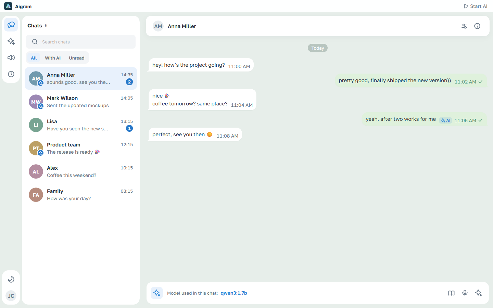
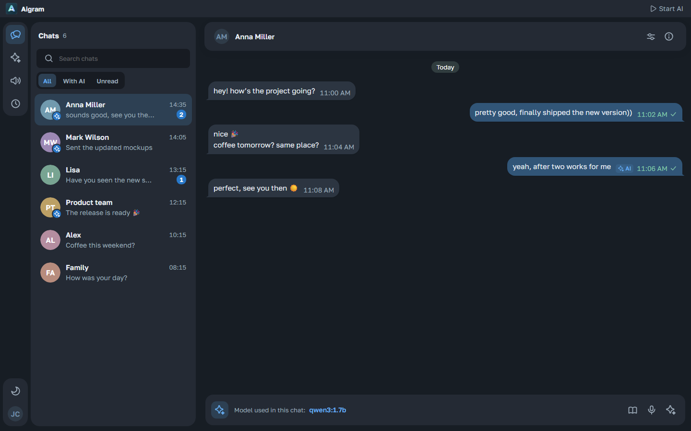
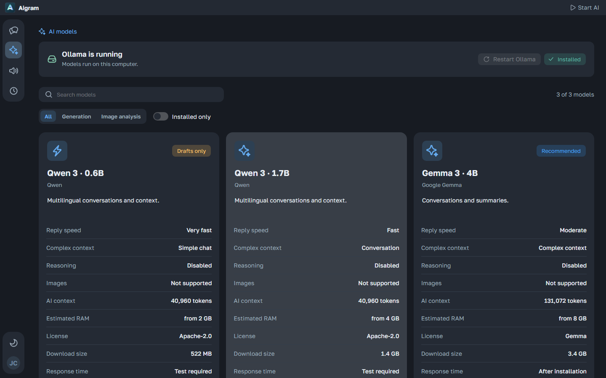
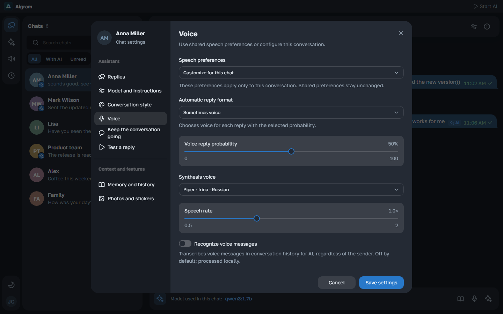
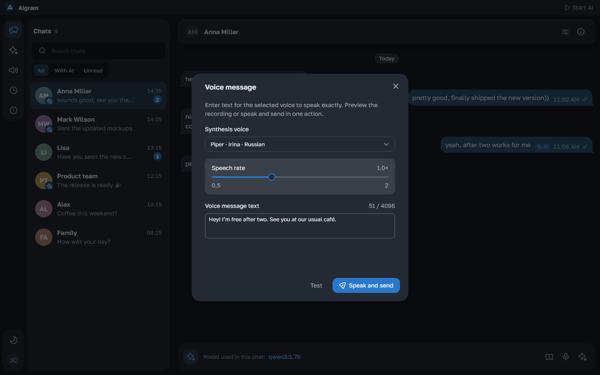
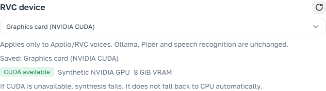

<p align="center"></p>
<h1 align="center">Aigram</h1>
<p align="center">Telegram conversations, your assistant, and the voices you choose.</p>
<p align="center">
  <a href="https://github.com/kreeeeeel/boltunya/actions/workflows/release.yml"></a>
  
  
  
  
  
  
  
  
</p>
<p align="center"><a href="https://github.com/kreeeeeel/boltunya/releases/latest">Download for Windows</a> · <a href="docs/ru.md">Русская документация</a> · <a href="#development">Development</a></p>

Aigram is a Windows desktop assistant for Telegram. Read conversations, prepare editable AI replies, choose a writing style for each chat, and keep useful facts in a local memory bank. Use an installed Ollama model or an API connection you configure. Local speech can transcribe voice notes and turn exact text or an AI draft into a native Telegram voice message.



*These screenshots use the English interface and synthetic conversations or hardware fixtures. The [Russian guide](docs/ru.md) has its own Russian screenshots. No private Telegram history is included.*

<table>
  <tr><td></td><td></td></tr>
  <tr><td></td><td></td></tr>
  <tr><td colspan="2"></td></tr>
  <tr><td colspan="2"></td></tr>
</table>

## What it does

- **Read Telegram conversations.** Search chats, view group authors and reply threads, and read native formatting, spoilers, links and received media. History loads gradually while preserving your scroll position.
- **Prepare and control replies.** The conversation assistant offers AI text drafts and voice drafts. Edit a generated text draft before sending, or write exact text in the voice composition dialog.
- **Choose a tone per chat.** Built-in and named custom styles remain separate from factual memory. Optional writing-style adaptation uses real outgoing messages and excludes known AI replies. Edit your own Telegram text and photo/video captions while preserving their existing formatting.
- **Choose local or connected models.** Browse Ollama models, compare context and memory estimates, install missing models with visible progress and cancellation, and benchmark installed models. Saved API connections can serve replies, memory or image analysis. App-managed Ollama has explicit CPU/GPU controls; external services retain their own configuration.
- **Use local speech.** The dedicated catalog offers Russian/English voices, recognition models and optional engines. Cards show format, dependencies, total download size and source. Test a voice in a separate dialog. Sherpa/Piper handles local synthesis; compatible character packs use the optional Applio/RVC dependency. **Settings → Compute** selects CPU or compatible NVIDIA CUDA for RVC; voice testing remains in **Assistant → Voice**. Per-chat voice settings inherit global preferences or override them. [Speech setup](docs/speech/en.md) · [Catalog and provenance](docs/speech/catalog-en.md).
- **Keep factual memory.** Shared owner facts, per-chat summaries and editable notes stay in local files. Automatic collection follows the configured interval; explicit collection and deep rebuild remain available. Source batches adapt to the model's token budget, with visible progress and cancellation. [Memory details](docs/memory/en.md).
- **Support a conversation when asked.** Opt in to an AI-written or exact predefined message after a chosen idle period. The assistant waits for a real response before another initiative. New incoming messages can replace an active reply, follow it as a combined task, or receive separate sequential replies. [Conversation support](docs/ai/conversation-support-en.md).
- **Inspect the shared queue.** Replies, drafts, speech and memory share a controllable queue. Pause, prioritize or cancel work; inspect model input, available thinking, final output and timing/token metrics. Completed replies support local ratings and comments.
- **Manage a desktop application.** Use the tray, separate Windows-startup and AI-resume preferences, a draggable title bar and storage folders that open in Explorer. The download center shows engine/model transfers, progress, speed and cancellation. Settings have grouped navigation, compact controls, four languages and built-in light/dark themes. Golos Text is bundled locally.

The AI badge appears on enabled contacts' avatars. **Esc** closes the current conversation after dismissing any open dialog. Chat wallpapers appear only while that conversation is open, with a neutral theme background when an image is unavailable.

## Get started

1. **Download Windows x64.** Get **Aigram.exe** from [Releases](https://github.com/kreeeeeel/boltunya/releases/latest). The portable package includes Electron, the Kotlin backend, a Java runtime and the web interface. Java and Node.js do not need a separate installation. TDLib may require the [Microsoft Visual C++ x64 runtime](https://aka.ms/vs/17/release/vc_redist.x64.exe).
2. **Connect Telegram.** Obtain your own API ID and API Hash at [my.telegram.org/apps](https://my.telegram.org/apps), then enter your phone number, login code and two-step password when requested.
3. **Choose a model.** Existing local Ollama installations and complete models are detected. Open **AI models** to install additional models or configure an API connection in settings. Model weights and optional speech engines are separate downloads; inspect their size before starting.
4. **Configure a chat.** Set its tone, context and reply preferences. Automatic sending and voice features are optional. Starting AI displays model warmup while it prepares an installed model.

Saving settings keeps the dialog open and briefly changes the button to **Saved**. The conversation assistant keeps AI text and voice drafts under your control before manual delivery. Model behavior varies; review drafts and choose the conversations where automation is appropriate.

## Data and privacy

The profile lives under `%LOCALAPPDATA%\Aigram`, including Electron data in `desktop/browser`. A normal launch can safely copy an existing legacy Tiho profile, verify it and switch directories atomically; original folders remain for recovery. Migration waits for the previous application to close and is deferred during an active legacy update handoff. Explicit data-directory overrides retain their behavior. [Storage and migration](docs/storage/en.md).

| Location | Contents |
| --- | --- |
| `settings.json` | Preferences, chat rules and owner instructions |
| `models/` | Saved connections, protected credentials and per-model prompts |
| `memory/` | Factual summaries, owner profile, collection state and manual notes |
| `telegram/`, `history/` | Telegram session, media and observed local message snapshots |
| `speech/` | Optional speech runtimes, installed models and generated local audio |
| `activity/`, `feedback/` | Task traces and response ratings |
| `desktop/updates/`, `desktop/browser/` | Update handoff state and Electron storage |

Native Ollama weights normally live in `%USERPROFILE%\.ollama\models` or `OLLAMA_MODELS`. External services and containers may use another location; the storage panel distinguishes these cases. Telegram credentials and model API keys use Windows DPAPI. Login codes and Telegram two-step passwords are not persisted by the application.

Selecting an API model sends the required task context to that configured endpoint and may incur provider charges. Local memory and task traces can contain private conversations: do not share the profile or trace details indiscriminately. Clearing downloaded media preserves sign-in, settings and memory. Full exit stops app-managed Ollama and leaves independently managed services running.

## Development

Use **Windows x64, JDK 21 and Node.js 24**. From the repository root:

```powershell
npm.cmd ci --prefix web
npm.cmd ci --prefix desktop
npm.cmd exec --prefix web -- playwright install chromium
./scripts/build.ps1
./scripts/test-web.ps1
npm.cmd run test:smoke --prefix desktop
npm.cmd run test:updater --prefix desktop
```

The build generates the canonical API client, checks Kotlin/frontend/Electron sources, exports the web interface and packages `complie/Aigram.exe` with `SHA256.txt`. Browser and native smoke tests use synthetic or isolated profiles. They do not sign in to Telegram.

| Directory | Responsibility |
| --- | --- |
| `desktop/` | Electron shell, preload, updater, tray and Windows startup |
| `backend/` | Kotlin, Spring Boot/MVC, Spring AI, TDLib, speech, memory and task scheduling |
| `backend/contract/` | Canonical OpenAPI source and generated server/Kotlin/TypeScript clients |
| `web/` | React, Next.js static export, Gravity UI and the generated API SDK |
| `scripts/`, `.github/workflows/` | Checks, packaging and release automation |
| `docs/` | English/Russian documentation and synthetic screenshots |

Spring MVC controllers implement generated interfaces. Feature components own business operations; extension functions map domain values to transport DTOs. The frontend calls generated operations from `@aigram/api-client`. Runtime settings and memory remain local JSON/Markdown files. [Architecture](docs/architecture/en.md) · [API clients](docs/api-client/en.md) · [Migration checkpoint](docs/migration/en.md).

Standalone web checks require generated SDK output:

```powershell
./gradlew.bat :backend:contract:client:typescript:generateClient --no-daemon
npm.cmd run check --prefix web
./gradlew.bat check --no-daemon
```

After a testing web build is running, refresh the localized documentation gallery with synthetic data:

```powershell
$env:TIHO_TEST_URL='http://127.0.0.1:3100'
Push-Location web
npm.cmd exec -- playwright test docs-screenshots.spec.ts --reporter=list
Pop-Location
```

The scenario writes six screenshots per language under `docs/resources/en/` and `docs/resources/ru/`; it makes no real Telegram or model requests. [Docker tooling](docker/README.md) describes static frontend and JVM checking environments.

## Releases and troubleshooting

The **Windows release** workflow checks sources, packages the portable application and runs browser/native regressions before publishing **Aigram.exe** and **SHA256.txt**. A byte-identical **Boltunya.exe** alias supports updates from older installations. The latest release link identifies the published version; screenshots and source documentation do not establish that an unpublished build has passed release checks.

Packaged launches check stable GitHub Releases in a small startup window. Downloads are verified against the published SHA-256. The helper acknowledges readiness before the old process exits, and the replacement must confirm backend/UI startup before its backup is removed. Failure keeps or restores the previous version. Windows startup follows the same check and then leaves the application in the tray. No GitHub token is required.

If an old updater closed the app without reopening it, launch a freshly downloaded `Aigram.exe` once manually. Current failures appear beside the affected action; AI task outcomes remain in Events. The application has no separate Errors page or persistent technical error journal. Existing legacy log files are left untouched and are no longer read.

[Settings](docs/settings/en.md) · [Speech](docs/speech/en.md) · [Memory](docs/memory/en.md).

See [NOTICE.md](NOTICE.md) for third-party notices and model provenance. Golos Text uses the [SIL Open Font License](web/src/shared/assets/fonts/OFL-GolosText.txt). Model and optional runtime licenses differ. Aigram is independent and is not affiliated with Telegram or the owners of character voices.
