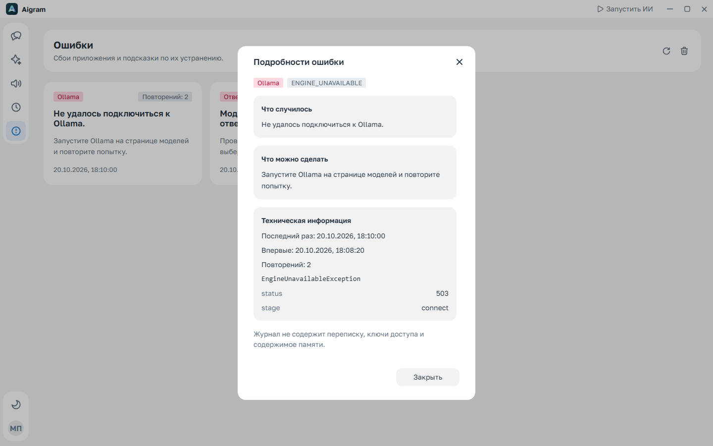
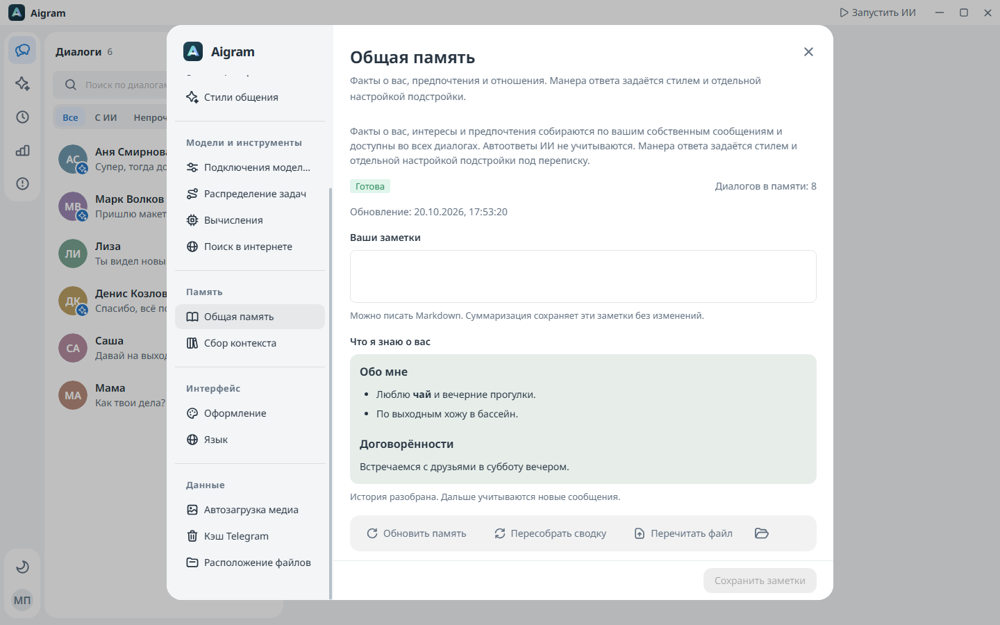
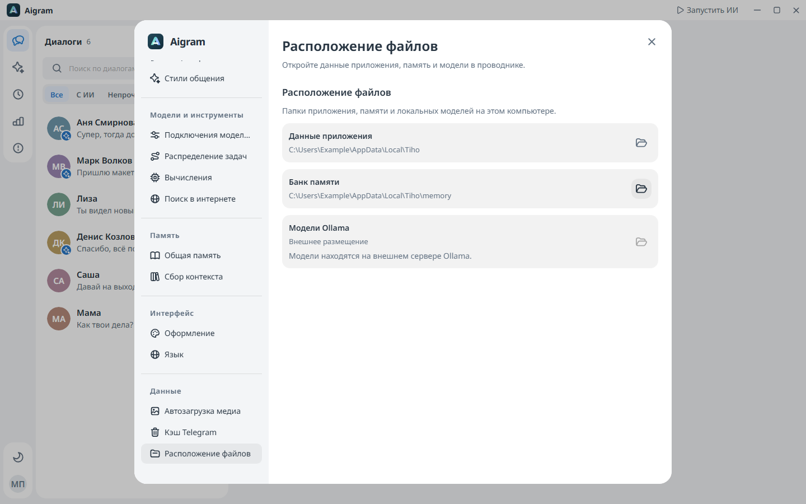
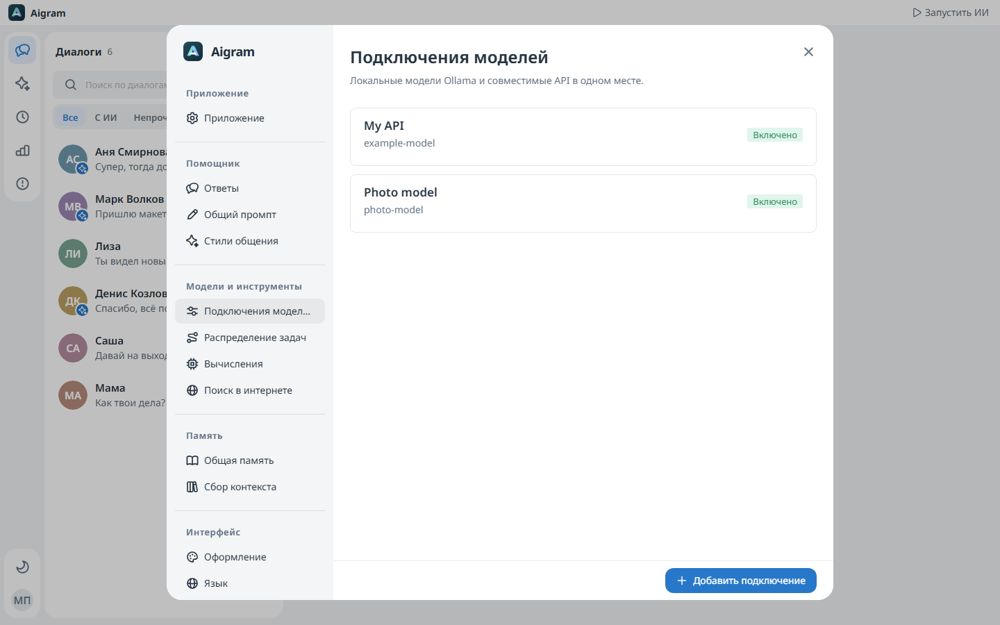
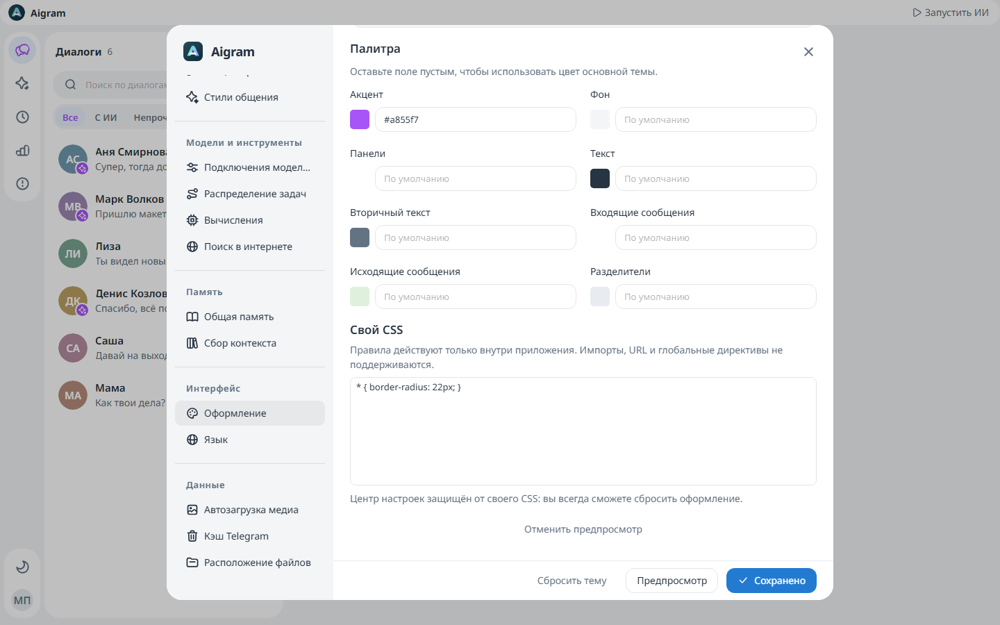
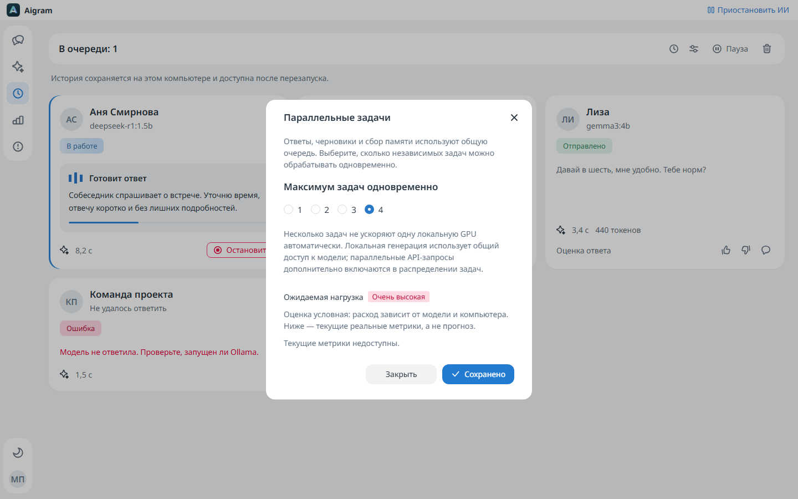
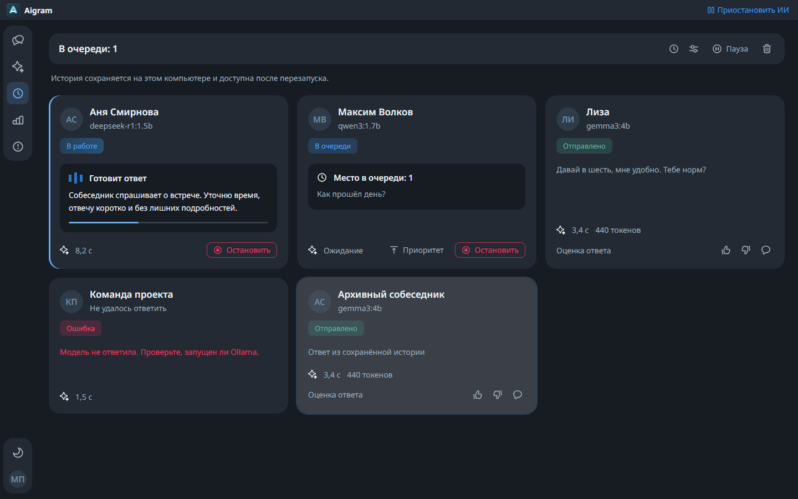
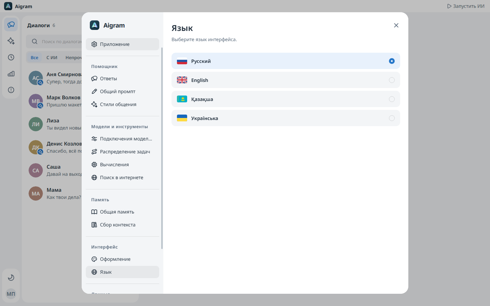

<p align="center"></p>
<h1 align="center">Aigram</h1>
<p align="center">Telegram, your voice, and the models you choose.</p>
<p align="center">
  <a href="https://github.com/kreeeeeel/boltunya/actions/workflows/release.yml"></a>
  
  
  
  
  
  
  
  
</p>
<p align="center"><a href="https://github.com/kreeeeeel/boltunya/releases/latest">Download for Windows</a> · <a href="docs/ru.md">Русская документация</a> · <a href="#development">Development</a></p>

Aigram is a Windows desktop application for reading Telegram conversations and managing a personal AI assistant. Choose who it can reply to, shape its tone, and let local or API-connected models use conversation history and long-term memory. You can also write replies yourself and look up current information without a paid search API.


*Screenshots use synthetic conversations and illustrative data. No personal Telegram history is included.*

## What it does

- **A familiar conversation view.** Avatars, formatted text, clickable links, replies, photos, video, audio, documents, spoilers and static/animated stickers. Group messages show author photos and names, with consecutive messages grouped by sender. The selected conversation's wallpaper spans the workspace behind opaque panels and floating navigation. History loads as you scroll without losing your position.
- **An explicit tone per conversation.** The selected built-in or named custom style is a separate system instruction. Optional adaptation uses only real outgoing messages and cannot replace that style. Known AI replies are excluded.
- **Local models with a useful catalog.** Search downloadable models across Qwen, Gemma, DeepSeek, GPT-OSS, Llama, Mistral and Phi. Compare memory estimates, context, reasoning, license and download size; measure speed on your own machine. Install Ollama and models from the application with progress feedback.
- **Explicit compute selection.** Choose automatic placement, CPU or a detected NVIDIA GPU for app-managed Ollama. External services remain under their own configuration; AMD and Intel use Ollama's automatic selection. [Device settings](docs/ai/gpu-en.md).
- **Current information, naturally phrased.** Keyless search, Open-Meteo weather, dated news and official exchange rates. Short follow-ups retain the previous topic. Replies are instructed to preserve significant digits and dates while matching your style; links are limited to retrieved sources and follow your preferences.
- **A memory bank you control.** Shared owner facts and habits, per-chat summaries, editable notes, incremental background collection and manual deep rebuilds with progress, queue state and cancellation.
- **Opt-in conversation support.** Globally or per chat, resume an idle conversation after a configurable interval. Initiatives use the shared queue and wait for a real response before sending another. [How it works](docs/ai/conversation-support-en.md).
- **One controllable queue.** Automatic replies, manual drafts and memory collection share a queue. Keep processing sequential or allow up to four concurrent tasks, with resource guidance, cancellation and priorities. Delivery to each conversation remains ordered. Group automation starts disabled.
- **A visible reply queue.** Pause dispatch, prioritize or stop tasks, inspect prompts, streamed thinking, responses and token/timing metrics, and rate completed replies with an optional comment. Full traces persist locally and load in pages across restarts. [Queue and trace details](docs/activity/en.md).
- **Built-in troubleshooting.** The Errors page groups failures into cards with a timestamp, occurrence count, explanation and recovery steps. Detail dialogs show safe technical metadata, without copying conversation text or credentials into the error log.
- **A proper desktop shell.** A draggable title bar, maximize within the Windows work area, compact tray menu, optional startup in the tray, and separate startup/resume preferences. Resource charts show application and system activity.
- **A settings center.** Grouped sidebar navigation, saved model connections, task routing, memory, owner instructions, local storage and a recoverable appearance editor with scoped custom CSS. English, Russian, Kazakh and Ukrainian; light/dark themes and bundled Noto Sans typography.
- **Media and context controls.** Send photos, albums, documents and Telegram stickers; browse photos and video in a separate viewer. Exclude a message or a range from AI context without hiding it from the conversation. Image analysis and automatic sticker replies are opt-in.

The chat list uses two-line previews and a small AI badge on enabled conversations' avatars. Press **Esc** to close the current chat; an open dialog is dismissed first. Telegram chat-specific and default light/dark wallpapers are supported when TDLib provides them. Conversation backgrounds appear only while a chat is open on the Chats page. The default conversation background is plain and follows the application theme; unavailable images also use this neutral background.

<table>
  <tr><td></td><td></td></tr>
  <tr><td></td><td></td></tr>
  <tr><td></td><td></td></tr>
  <tr><td></td><td></td></tr>
  <tr><td></td><td></td></tr>
  <tr><td></td><td></td></tr>
</table>

## Get started

Conversation prompts follow the selected tone and owner instructions. They do not inject a shared disagreement or refusal template. Individual models can still have their own response policies.

**Windows x64** is supported. Download **Aigram.exe** from [Releases](https://github.com/kreeeeeel/boltunya/releases/latest) and open it. The portable EXE includes Electron, the Kotlin application, a Java runtime and the static web interface. A separate Java or Node.js installation is not needed to run it. Ollama and model weights are additional downloads managed from the model page. TDLib may require the [Microsoft Visual C++ x64 runtime](https://aka.ms/vs/17/release/vc_redist.x64.exe).

1. **Connect Telegram.** Obtain your own API ID and API Hash at [my.telegram.org/apps](https://my.telegram.org/apps), then follow the sign-in form. In-app guidance explains these fields, the login code and two-step verification.
2. **Choose a model.** Open **AI models**. Existing Ollama installations and downloaded models are detected automatically; complete local models are recognized even while the server is stopped. Install Ollama only if it is missing, then download any additional model you want. Speed and memory labels are estimates; the benchmark measures actual local performance.
3. **Configure a conversation.** Open its conversation settings, enable replies and choose a model, tone, context and writing-style adaptation. Review global instructions in **Settings → Replies**. Configure API connections in **Settings → Models** if needed.
4. **Start AI.** Use the title-bar control, or enable **Enable AI when the app starts** in settings. This applies to both ordinary launches and Windows startup. Starting with Windows keeps the window hidden in the tray until you open it.

Saving general settings, conversation settings or global instructions keeps the dialog open. The save button briefly displays a success icon and **Saved**, then returns to its usual state. Further edits clear the confirmation; close the dialog separately when finished. Private conversations retain separate incoming and outgoing model roles. Group context and web-search planning also include participant names, stable sender identifiers and reply references, so messages from different people remain distinguishable. Refreshing the latest history page replaces Telegram's temporary send identifiers while retaining older pages and deliberately repeated messages.

While an automatic reply is queued or generated, the open conversation displays the same process block as Events: the current phase, available streamed thinking, elapsed time and a stop action. Stopping is disabled once delivery has started.

Screenshots: [reply progress](docs/resources/chat-generation.png) · [saved settings](docs/resources/settings-saved.png).

Chat controls: [stickers](docs/resources/stickers-dark.png) · [message context menu](docs/resources/message-menu-left-dark.png) · [task model filters](docs/resources/task-models-dark.png) · [local task routing](docs/resources/task-routing-dark.png).

Use the profile menu to open the settings center or sign out. Language, appearance, custom styles, shared memory and owner instructions have dedicated settings sections. Conversation settings contain memory collection and per-chat preferences. Memory summaries render Markdown, including headings, lists and emphasis. Photos, other media and deleted-message snapshots have cache and retention controls. The storage section lists actual data locations and opens available folders in Windows Explorer; external Ollama services are identified separately.

## Data and privacy

Local inference runs through Ollama. Configuring and selecting an API connection sends the context required for that task to the endpoint you choose; this can include conversation messages, memory and explicitly enabled images. Provider requests can incur charges. API keys are protected with Windows DPAPI, bound to their saved endpoint and never returned to the web interface. Telegram connectivity uses TDLib. When web search is enabled, external services receive a short generated query; weather services receive a city. The application does not send entire conversations or Telegram credentials to search providers. Exa MCP is an **optional** fallback with your own key; the default search path needs no key.

The persistent profile is `%LOCALAPPDATA%\Aigram`, including the Electron profile under `desktop/browser`. On a normal launch, the application safely copies an existing Tiho profile and its selected Electron profile, verifies the copy and switches directories atomically. The original folders remain as a recovery backup; new writes use Aigram. Migration waits until the old application is closed and is deferred during an active legacy update handoff. Explicit data-directory environment overrides retain their existing behavior. See [profile migration](docs/storage/en.md#profile-migration).

| Location | Purpose |
| --- | --- |
| `settings.json` | Preferences, conversation rules and instructions |
| `models/prompts.json` | Per-model instructions, local working context and token estimate preferences |
| `activity/` | Account-scoped event archive, trace details and storage policy |
| `models/profiles.json`, `models/credentials/` | Model connection metadata and DPAPI-protected secrets |
| `appearance.json` | Theme tokens and validated workspace CSS |
| `automation/initiatives.json` | Account-scoped follow-up delivery checkpoints; no message text |
| `context-exclusions/` | Account-scoped AI context exclusions |
| `telegram.credentials` | API credentials protected by Windows DPAPI |
| `telegram/` | TDLib session database and downloaded media |
| `memory/MEMORY.md`, `memory/<account-id>/<chat-id>/MEMORY.md` | Shared and conversation memory with editable notes |
| `memory/<account-id>/PROFILE.md`, `state.json` | Account-specific automatic owner profile and collection cursors |
| `history/`, `automated-replies.json` | Observed message snapshots and known AI message IDs |
| `engine/` | App-managed Ollama runtime |
| `diagnostics/` | Bounded technical error history |
| `feedback/activity.json` | Local response ratings and optional comments |
| `desktop/updates/` | Verified update downloads and installer state |
| `desktop/browser/` | Electron preferences, browser storage and cache |

Native Ollama model weights usually live in `%USERPROFILE%\.ollama\models`, or the location set by `OLLAMA_MODELS`. A separate service or container can use a different directory. The application's storage panel distinguishes these cases instead of inventing a local path for a remote service.

Login codes and Telegram two-step passwords are not persisted by the application. Local memory and message snapshots contain private information; the profile, credentials, build outputs and local logs are excluded from Git. Deleted messages can only be retained if the application observed them beforehand. Clearing downloaded media does not sign you out or remove your settings and memory.

Full exit stops the application-managed Ollama process. An independently managed Ollama server is left running. Closing to the tray keeps the application active according to your settings.

## Project structure

| Directory | Responsibility |
| --- | --- |
| `desktop/` | Electron window, isolated preload, native lifecycle, tray and startup |
| `backend/` | Kotlin/JVM, Google Guice, TDLib, automation, search, memory and local API |
| `web/` | TypeScript, React, Next.js static export, Gravity UI and generated API types |
| `.github/workflows/` | Windows checks, portable packaging and GitHub Releases |
| `docker/` | Development/checking containers; not the signed-in desktop application |
| `scripts/` | Windows build, icons and browser verification |
| `docs/` | English/Russian feature documentation and synthetic screenshots |
| `complie/` | Generated EXE and SHA-256 checksum; intentionally ignored by Git |

The Kotlin package is `ru.aigram`. Prompts, literal language vocabularies, errors and model metadata live in backend resources. The OpenAPI contract is `backend/contract/api.yaml`; `openapi-typescript` generates the frontend types. The local API uses a private loopback session and Host/Origin checks. The renderer has no Node.js access.

Spring AI's Ollama and OpenAI adapters provide typed requests, structured responses, separate thinking output and inference statistics. Saved connections and optional task routes choose an installed local model or API connection separately for replies, memory, research and vision. See [task routing and image analysis](docs/ai/tasks-en.md). Local tasks share a resource gate, while independent endpoints can run concurrently within the queue limit. `ConversationService` coordinates search and final replies; `ChatCompletionService` owns inference, and `OllamaRuntime` owns local model management. Spring AI `ChatMemory` builds the recent conversation window; the Markdown memory bank retains long-term summaries and owner facts. Guice wires these services without starting a Spring Boot application. See [AI architecture](docs/ai/en.md).

Prompt settings show the selected model’s working context, reserved output budget and estimated space remaining for history. Independent instructions can be saved per model and connection. Oversized mandatory context fails explicitly without silently losing the latest question. [Token budgets and model prompts](docs/ai/prompts-en.md).

Conversations follow the global model selection by default; an explicit per-chat override remains available. Speed measurements persist across restarts and run automatically when you select an unmeasured installed model. Downloads use an inline progress button with cancellation.

## Development

Use **Windows x64, JDK 21 and Node.js 24**. From the repository root:

```powershell
npm.cmd ci --prefix web
npm.cmd ci --prefix desktop
npm.cmd exec --prefix web -- playwright install chromium
./scripts/build.ps1
./scripts/test-web.ps1
npm.cmd run test:smoke --prefix desktop
npm.cmd run test:updater --prefix desktop
```

The build runs Kotlin, frontend and Electron checks, exports the web interface, creates a minimal Java runtime and writes `complie/Aigram.exe` plus `SHA256.txt`. Browser tests serve the static export on a temporary local port. Native smoke tests use an isolated data directory and do not sign in to Telegram.

The native update regressions cover helper startup failure, a replacement that starts then crashes, healthy startup confirmation and rollback. For a staging build, pass `-OutputDirectory complie/.staging -SkipShortcut`. Native smoke tests accept `AIGRAM_TEST_EXECUTABLE` (or its legacy alias `BOLTUNYA_TEST_EXECUTABLE`) to select the staging package's unpacked executable. CI skips local shortcut creation and publishes only after validation.

For targeted checks:

```powershell
$env:JAVA_TOOL_OPTIONS='-Djdk.net.unixdomain.tmpdir=C:/tiho-no-unix-sockets'
./gradlew.bat check --no-daemon
npm.cmd run check --prefix web
npm.cmd run check --prefix desktop
```

Optional live research tests require a running Ollama server with **gemma3:4b** already installed and internet access. They use synthetic questions about weather, news, currencies and follow-ups; they neither download models nor send Telegram messages.

```powershell
$env:TIHO_LIVE_INTERNET='true'
./gradlew.bat :backend:test --tests 'ru.aigram.ai.Live*' --no-daemon
```

To check conversation quality on **every installed model**, use the separate 20-scenario matrix. It exercises real local inference with synthetic conversations and deterministic weather/news/rate fixtures, including topic follow-ups, owner-style samples, six conversation tones, reasoning separation and complete final answers. It does not install missing catalog models. Reports are written to `backend/build/reports/model-quality.json` after each case.

```powershell
$env:TIHO_LIVE_AI='true'
./gradlew.bat :backend:test --tests 'ru.aigram.ai.LiveModelQualityTest' --no-daemon
```

The current `qwen3:4b` tag requires thinking and is listed separately from its instruct variant. Reasoning stays in its own channel. Empty or provider-truncated responses fail explicitly; ordinary repeated phrases and writing style are not classified with handwritten regular expressions. A bounded correction is reserved for exact facts retrieved by search. Memory supplies confirmed owner facts, relationships and arrangements, rather than writing instructions. Optional observations of manual outgoing messages remain separate from memory and subordinate to the selected tone. The optional “Ignore assistant tasks” setting skips requests such as recipes before automatic generation; manual previews can still test them.

Active streaming generation has no three-minute total deadline. An inference stream fails after ten minutes without a new chunk; thinking chunks count as progress. Tasks can still be stopped from the queue. Response ratings are local feedback, not automatic model training.

Models that fail the application's automation checks are labelled **Drafts only**. In this release, `qwen3:0.6b` is restricted after a harmful-request test failure: it can be downloaded, selected while AI is paused and used for manual previews, while automatic sending is rejected. The application keeps the model you selected. Explicit requests to recall earlier facts allow those facts to be repeated. You can exclude individual messages or ranges from future model context using the message context menu. This also rebuilds affected automatic memory while preserving manual notes. The original conversation remains visible.

Recorded model results and the complete synthetic outputs are available in the [installed-model quality report](docs/ai/model-quality-2026-10-16.md). It includes failures and manual review findings; passing the automated checks does not certify a model for every conversation.

The [20 October follow-up](docs/ai/model-quality-2026-10-20.md) verifies final/thinking separation on the currently installed R1 and GPT-OSS models and records the remaining tone-compliance failures.

The [21 October focused check](docs/ai/model-quality-2026-10-21.md) verifies factual recall and business wording with the new memory/style separation. It also records R1's failure to start streaming and GPT-OSS's remaining rough-style failure.

See [Docker tooling](docker/README.md) for a static frontend preview and JVM checks. The Telegram desktop session and Windows DPAPI remain native.

## Releases

Every push to `main`, or a manual **Windows release** run, checks and builds the application on GitHub Actions. It then runs browser and native Electron tests before publishing **Aigram.exe** and **SHA256.txt** to [Releases](https://github.com/kreeeeeel/boltunya/releases). Release versions use the source major/minor and the workflow run number; each version has a separate portable extraction directory.

Releases also contain a byte-identical `Boltunya.exe` compatibility alias, with both filenames listed in `SHA256.txt`, so existing installations can update to Aigram. Telegram sessions, memory and settings stay in their existing profile.

The repository and releases are public. Packaged launches check the latest stable GitHub release in a small, draggable startup window. A newer portable EXE is downloaded, verified against its published SHA-256 and installed before the application starts. The installer must acknowledge readiness before the old process exits. The replacement must finish backend and interface startup before its backup is removed; failed startup rolls back and reopens the previous version. Network or verification failures leave the installed version available. Windows startup follows the same updater flow, then keeps the main application in the tray. No GitHub key is required.

If an older version downloaded an update, closed and never reopened, download and launch the current `Aigram.exe` once manually. Older helpers that fail before executing cannot install their own fix; subsequent updates use the acknowledged handoff and startup rollback protocol.

<p align="center"></p>

To verify a manual download:

```powershell
Get-FileHash -Algorithm SHA256 -LiteralPath '.\Aigram.exe'
Get-Content -LiteralPath '.\SHA256.txt'
```

## Further documentation

If AI does not respond on another computer, first open **Errors** and inspect the latest card's explanation and recovery steps. For a separate support report, download **Diagnose-AI.ps1** from the release, leave Aigram open and run it in PowerShell:

```powershell
powershell.exe -NoProfile -ExecutionPolicy Bypass -File .\Diagnose-AI.ps1 -TestModel
```

The report `aigram-diagnostics.json` is written to the Desktop. It contains runtime/model availability, RAM/GPU metadata, automation settings and structured generation status. The optional `-TestModel` runs a synthetic preview without sending a Telegram message. Without this flag, no generation runs. Chats, contact identifiers, API credentials, prompts, generated text and raw logs are excluded. Share the report together with the error text visible in **Events**; event details themselves can contain private conversations. See the [diagnostic guide](docs/diagnostics/ru.md) for interpreting results.

[Russian guide](docs/ru.md) · [Settings](docs/settings/en.md) · [Model connections](docs/ai/providers-en.md) · [Context controls](docs/conversation/en.md) · [Architecture](docs/architecture/en.md) · [Dependency injection](docs/dependency-injection/en.md) · [Memory bank](docs/memory/en.md) · [Web search](docs/internet/en.md) · [Storage and cache](docs/storage/en.md)

See [NOTICE.md](NOTICE.md) for third-party licenses and data sources. Noto Sans is bundled under the [SIL Open Font License](web/src/shared/assets/fonts/OFL.txt). Model licenses remain specific to each model. Aigram is an independent application and is not affiliated with Telegram.
