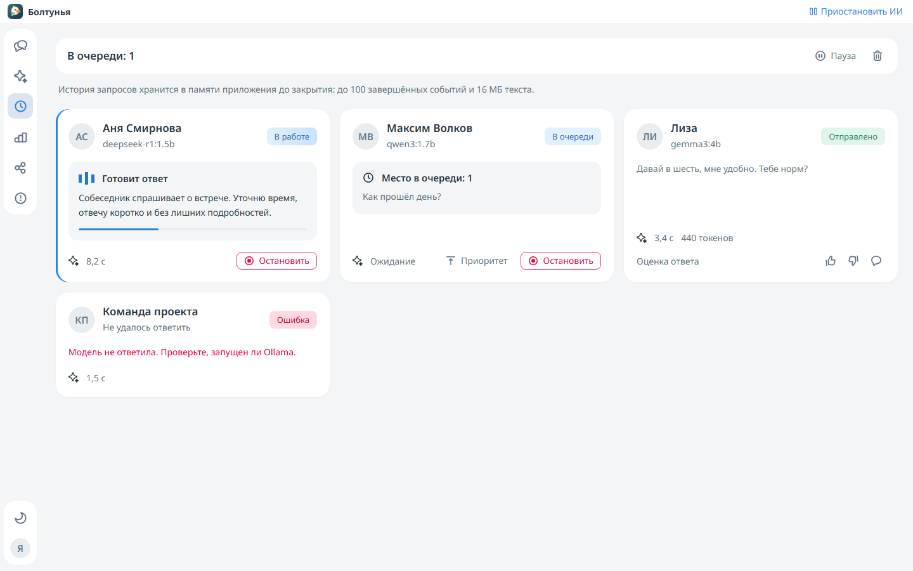
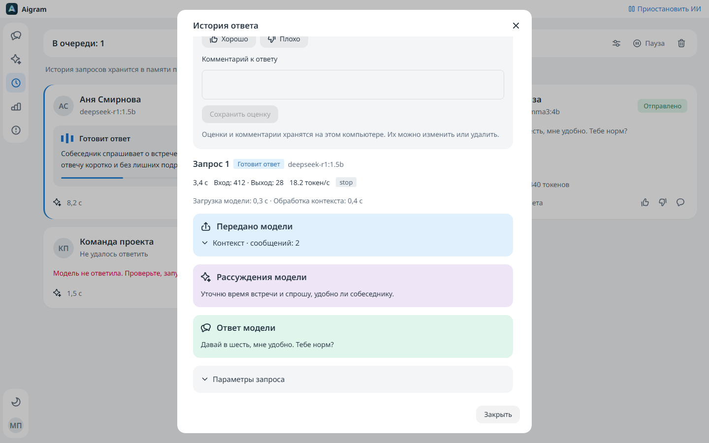

# Очередь ответов и история запросов

Событие появляется сразу после постановки подходящего сообщения в очередь. Карточки образуют сетку от одного до трёх столбцов и показывают имя и аватар беседы, тег статуса, этап работы и поступающие рассуждения, если модель предоставляет их отдельно. Пустая иллюстрация отображается только при отсутствии событий.

## Управление

- **Пауза / Продолжить** приостанавливает запуск, сохраняет очередь и продолжает принимать подходящие сообщения. Текущая задача может завершиться. Глобальная кнопка ИИ в панели окна отменяет ожидающую генерацию.
- **Приоритет** переносит задачу перед другими готовыми задачами. Он сохраняет задержки, интервалы отправки и ограничения Telegram, не прерывая текущую работу.
- **Остановить** отменяет ожидающую задачу или прерывает поток модели, блокируя доставку до начала отправки. После начала отправки кнопка отключается, API возвращает HTTP 409: уже переданную Telegram отправку это действие отозвать не может.
- **Очистить завершённые события** удаляет завершённую, ошибочную и остановленную историю, сохраняя ожидающие и работающие задачи.

Новое сообщение в той же беседе заменяет ожидающий ответ. Ручной ответ, удаление исходного сообщения, глобальная пауза и изменение настроек беседы отменяют устаревшую работу. Остановленные события остаются видны до очистки или вытеснения из истории.

## Подробности

Карточка открывает входящее сообщение, историю этапов, отправленный ответ и каждый запрос к модели, включая планирование поиска и повторные попытки. Контекст, рассуждения, исходный ответ и параметры оформлены отдельными скруглёнными блоками. Также доступны роли сообщений, переданных Spring AI, причина завершения и метрики провайдера. У сценария без узла модели запросов к ней не будет.

Расход токенов приходит от Ollama; выход включает рассуждения, если провайдер учитывает их таким образом. У прерванного запроса итоговый расход неизвестен: количество фрагментов потока не используется для оценки. Общее время включает контекст, поиск, генерацию и доставку. Время отдельного запроса, загрузки модели, обработки контекста и скорость токенов берутся из метаданных провайдера. Полоса генерации не показывает выдуманный процент.

## Хранение и приватность

Промпты могут содержать историю беседы, инструкции и память. Полный запрос доступен владельцу через защищённый локальной сессией API, загружается при открытии модалки и обновляется во время работы. При закрытии модалки запрос отменяется. Рассуждения не подменяют итоговый ответ Telegram.

История хранится в оперативной памяти до закрытия приложения, не записывается в консольные логи и не добавляется в сообщения Telegram. Сохраняются до 100 завершённых событий и до 8 миллионов символов UTF-16, примерно 16 МБ текста. Сначала вытесняются старые завершённые события, активные задачи сохраняются. Общее состояние содержит короткие сводки вместо полных промптов.

Маршруты `/api/activity`, `/api/activity/queue`, `/api/activity/{id}`, `/cancel` и `/priority` описаны в [OpenAPI](../../backend/contract/api.yaml). Тесты используют вымышленные беседы, подменённую доставку Telegram и потоки SDK. Дополнительный `LiveActivityTraceTest` проверяет установленные модели, не скачивая новые.
