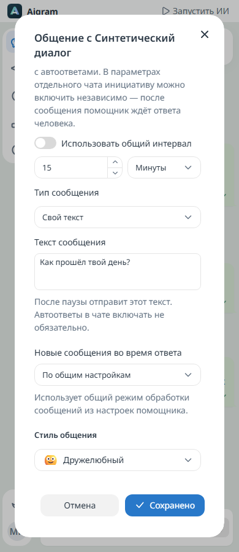

# Поддержка диалога

По умолчанию функция отключена. В параметрах чата можно явно разрешить сообщение после тишины и выбрать интервал в минутах или часах. Доступны **Сообщение от ИИ** с учётом контекста беседы и **Свой текст** для отправки точной заготовки без обращения к модели. Явное включение для чата работает независимо от автоответов. Наследование общего переключателя применяется только к чатам с включёнными автоответами. Самостоятельно приложение ничего не включает.

В **Настройки → Поддержка диалога** показаны все активные чаты с режимом сообщения и интервалом, с загрузкой списка по страницам. Из списка можно открыть параметры нужного чата, предварительно сохранив изменения общих настроек. Там же находятся общий переключатель и интервал по умолчанию; нулевой интервал чата наследует общий. Свой текст ограничен 4096 единицами UTF-16 и отправляется буквально, включая символы, похожие на Markdown.

Aigram рассматривает только присоединённые беседы из списка Telegram. Непрочитанных сообщений и печатающих участников быть не должно; последнее сообщение может быть от любого участника. «Избранное» и каналы рассылок исключены. В группах дополнительно должны быть разрешены ответы; при режиме «Только упоминания» требуется явное включение инициативы в этой беседе.

Интервал отсчитывается с момента наблюдения подходящего состояния, а не от даты старого сообщения. Запуск приложения, включение функции и снятие паузы очереди не вызывают немедленную отправку во все старые чаты. Проверка выполняется каждые 30 секунд. Обычные задержки, интервал отправки и занятая очередь могут отложить ответ. Одновременно в очереди или работе находится не больше одной инициативы.

В событиях появляется отдельное задание поддержки диалога. Его можно отменить или повысить приоритет. В режиме ИИ модель получает настоящую историю, фактическую память, выбранный стиль и инструкции владельца с дополнительным указанием естественно продолжить общение. Свой текст отправляется без генерации. Входящее сообщение собеседника не придумывается. Поиск и автоматическая отправка стикера для такой инициативы отключены.

Перед отправкой повторно проверяются аккаунт, последнее сообщение и разрешения. Новое входящее сообщение делает подготовленную инициативу неактуальной. Запрет повтора записывается на диск до обращения к Telegram. После попытки отправки Aigram ждёт нового настоящего ответа собеседника. Ручные исходящие, сообщения ИИ и удалённые сообщения не снимают это ограничение. Состояние переживает перезапуск в `automation/initiatives.json` внутри профиля Aigram; текст переписки в этот файл не записывается.

После ошибки генерации или отмены до отправки повторная попытка возможна через выбранный интервал. Если результат отправки неизвестен, автоматического повтора нет: Telegram уже мог принять сообщение. Перезапуск начинает новый период наблюдения, сохраняя запрет повторной инициативы без ответа. Функция предназначена для отдельных бесед с явным разрешением и не гарантирует отправку ровно в указанную секунду.

Настройки API: `proactiveEnabled`, `proactiveIntervalMinutes`; правило чата: `proactiveMode` (`inherit`, `disabled`, `enabled`), `proactiveIntervalMinutes` (`0` наследует общий интервал), `proactiveMessageMode` (`ai` или `text`, по умолчанию `ai`) и `proactiveText`. Сохранённые правила сохраняют прежний режим ИИ и состояние разрешений.

