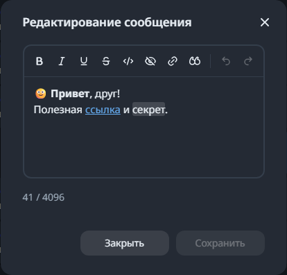

# Editing sent messages

Open the context menu on your own text, photo or video and choose **Edit**. Telegram decides whether the message is still editable; Aigram checks that permission when opening the editor and again when saving. Received and deleted messages cannot be edited.

The visual editor provides bold, italic, underline, strikethrough, monospace, spoilers, links and quotes, with undo/redo. Existing Telegram entities retain their complete metadata on the backend. Custom emoji and user mentions remain atomic, so a partial text edit cannot corrupt their identity. Plain text that looks like Markdown stays literal. Newlines, surrounding spaces and overlapping entity ranges are not converted through Markdown or HTML when saving.

**Save** waits for Telegram's confirmed result, updates the existing message and keeps the editor open. The normal message composer's draft stays untouched. A saved edit receives an **edited** marker. If another client changed the message after the editor opened, the draft is retained and the user can explicitly reload Telegram's version. Closing or reloading with unsaved changes asks before discarding them. A failed editor refresh after a confirmed save offers a read retry rather than repeating the edit.

Photo/video edits change the caption, preserving the original media and its caption placement. Text edits retain link-preview options. Clearing a caption is allowed; an empty text message is not. Telegram's configured text/caption limits are used instead of a single hardcoded limit.

## Consistency and integration

The canonical contract adds `GET` and `PUT /api/chats/{chatId}/messages/{messageId}/edit`. The read returns exact text, UTF-16 entity ranges, opaque references to the original entities, a revision, caption/text kind and the active length limit. The write returns the confirmed, enriched message. Original entity metadata never needs to be reconstructed from a display hint in the browser.

Before editing, the backend rechecks ownership, permission, account/connection identity and a revision derived from the current Telegram content and options. App-local saves are serialized. TDLib does not provide an atomic compare-and-set edit: a change made in another client in the narrow interval between the final check and Telegram's edit remains subject to Telegram's ordering.

An edit replaces the local archived text and invalidates affected AI context. Obsolete personal writing samples are removed or updated; known automated replies retain their provenance and do not become owner-style examples. UI mutation guards stop a history request that started before saving from replacing the confirmed result, including edits with the same second-resolution timestamp.

This feature is verified using synthetic TDLib messages, test transports and browser fixtures; tests do not edit anyone's real Telegram messages.

## Optional AI reply formatting

**Settings → Assistant → Apply formatting** adds a separate reply instruction and is off by default. The model may use moderate bold, italic, strikethrough, spoilers, quotes, code and links; the selected communication style remains the priority.

The existing CommonMark parser produces native Telegram entities with UTF-16 offsets. Unsupported image markup or unsafe links preserve the entire literal response instead of discarding content. Generated drafts retain their entities in the compact visual composer, including after edits and when transferred to the first attachment caption. Ordinary manually typed text stays literal. Types, overlap, URLs and Unicode boundaries are validated before cancelling queued work or consuming uploads.

History still uses role `user` with verified author metadata in JSON envelopes. A separate output instruction requires only the final message. If a model nevertheless emits that exact envelope, the backend extracts `message`; malformed recognized metadata fails explicitly. Ordinary JSON/code responses, research plans and sticker schemas retain their separate handling.
