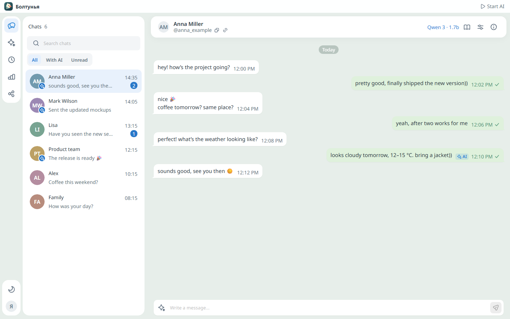
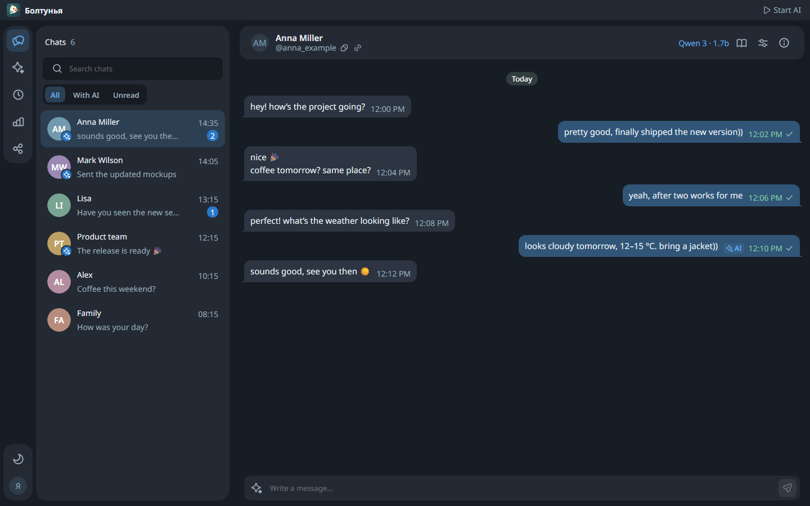
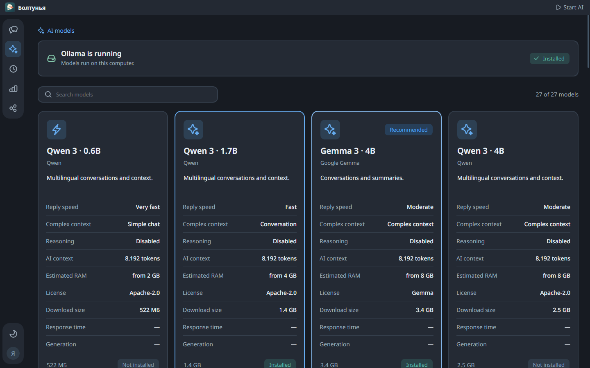
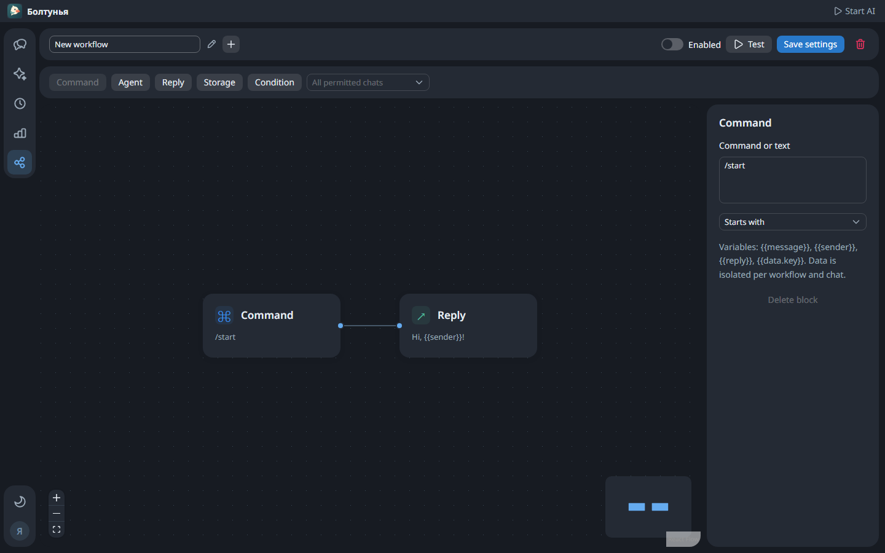

# Болтунья

[English README](../README.md) · [Скачать Windows EXE](https://github.com/kreeeeeel/boltunya/releases/latest)

Болтунья — приложение для Windows, в котором можно читать переписку Telegram, отвечать вручную или подключать локальный ИИ к выбранным диалогам. Помощник учитывает историю, общую память о владельце и привычную манеру письма. Для актуальных вопросов есть бесплатный поиск без обязательного API-ключа; для автоматизации — визуальные сценарии.



Скриншоты сделаны на вымышленных диалогах и примерах данных. Реальной переписки в репозитории нет. Интерфейс доступен на русском, английском, казахском и украинском.

## Установка и первый запуск

Нужна Windows x64. В [Releases](https://github.com/kreeeeeel/boltunya/releases/latest) скачайте **Boltunya.exe** и запустите его. Репозиторий приватный: для загрузки необходимо войти в GitHub с доступом к нему.

В одном portable EXE находятся Electron, Kotlin-приложение, Java runtime и веб-интерфейс. При запуске оболочка распаковывается в локальный кэш. Устанавливать Java и Node.js пользователю не требуется. Ollama и веса выбранных моделей скачиваются отдельно из приложения. Для нативной TDLib может потребоваться [Visual C++ Runtime x64](https://aka.ms/vs/17/release/vc_redist.x64.exe).

1. Нажмите **Подключить Telegram**. Получите собственные **API ID** и **API Hash** на [my.telegram.org/apps](https://my.telegram.org/apps). Рядом с полями есть инструкция и ссылка. Далее введите номер телефона, код и, если включён, пароль двухэтапной аутентификации.
2. Перейдите в **Модели ИИ**. Установите Ollama через интерфейс и скачайте подходящую модель. Загрузка показывает прогресс. Модели самостоятельно не скачиваются без вашего выбора.
3. Откройте диалог и его **Параметры общения**. Разрешите автоответы, выберите модель, стиль, объём контекста и дополнительные инструкции. Подстройку под вашу манеру можно включать отдельно.
4. Нажмите **Запустить ИИ** в верхней панели. После обычного запуска приложения помощник стоит на паузе. Запуск с Windows и автоматическое включение ИИ при таком запуске настраиваются независимо.

## Диалоги

В списке доступны поиск, вкладки «Все», «С ИИ», «Непрочитанные» и постепенная подгрузка контактов. Превью различает ваши сообщения и сообщения участников групп. В шапке беседы показывается тег пользователя с кнопками копирования тега и Telegram-ссылки; для групп — доступная информация об участниках.

В сообщениях поддерживаются форматирование, ссылки, цитаты, спойлеры, копирование кода, фото, видео, аудио, документы и статические/TGS/WebM-стикеры. История подгружается при прокрутке вверх с сохранением позиции. Дата закрепляется сверху при прокрутке. Используются обои конкретной беседы и общий фон Telegram для светлой/тёмной темы, когда TDLib их предоставляет. По умолчанию фон однотонный и соответствует теме приложения. Такой же нейтральный фон показывается, если изображение Telegram недоступно.

ИИ отмечается небольшой круглой меткой на аватарке контакта. Подписи стилей не занимают место в списке. **Esc** закрывает открытую беседу; если сначала открыто окно настроек, закроется оно.

В группах у входящих сообщений показываются фотографии участников. Имя находится у первого сообщения серии, аватарка — у последнего. Сообщения разных авторов, тем и дат не объединяются. При отсутствии фотографии отображаются инициалы.

Фон выбранной беседы виден только при открытом чате на странице «Диалоги». Он находится за непрозрачными панелями диалогов, шапкой и полем ввода. При закрытии чата, до входа и на остальных страницах используется обычный фон интерфейса. Боковая навигация собрана в отдельные скруглённые блоки, сплошной полосы под ней нет.

Автоответы отмечаются **ИИ** в интерфейсе Болтуньи. Эта метка не добавляется в текст Telegram. Отправка привязывается к исходному сообщению как ответ; для форумов сохраняется тема. Контекст модели включает текст и подписи вложений: распознавание изображений и речи в этот путь не входит.



## Модели и стиль общения

Для явно вредных просьб модель получает инструкцию отвечать коротким спокойным несогласием в манере владельца. Обычные вопросы, образные выражения и просьбы защитить свой аккаунт обрабатываются как нормальный разговор.

В каталоге 27 моделей семейств Qwen, Gemma, DeepSeek, GPT-OSS, Llama, Mistral и Phi. Поиск работает по названию, идентификатору и описанию. В карточке можно сравнить относительную скорость, качество работы с контекстом, режим рассуждений, контекстное окно, примерную память, размер загрузки и лицензию.

Скорость и требования зависят от компьютера. Встроенная проверка измеряет время ответа и скорость генерации на вашем устройстве. Модель для каждого диалога может отличаться от выбранной по умолчанию. Условия использования зависят от лицензии конкретной модели.

Помощник берёт образцы манеры из настоящих исходящих сообщений: слова, регистр, пунктуацию, сокращения и эмодзи. Известные автоответы ИИ исключаются. Общий профиль владельца помогает применять привычки и стиль в разных беседах. Выбранный стиль и явные инструкции дополняют эти сведения.

Свои стили создаются в меню профиля: название, эмодзи и инструкции. Стиль меняет подачу ответа; сведения о владельце и текущие факты не должны выдумываться ради роли.



## Поиск актуальной информации

Поиск включается в параметрах конкретной беседы. Личная переписка, короткие реакции и вопрос о времени компьютера обычно обходятся без интернета.

- Погода: Open-Meteo, уточнение города, текущие условия и прогноз на нужный день.
- Официальные курсы: XML Банка России с датой действия курса, учётом номинала и кросс-курсов. Это справочный курс ЦБ, а не цена покупки наличных в банке.
- Новости: датированные RSS РБК и ТАСС, отбор по теме и региону, отсечение старых и недатированных материалов.
- Остальные вопросы: DuckDuckGo с резервом Bing RSS. Exa MCP — дополнительный резерв, только если вы сами сохранили ключ; без ключа Exa не вызывается.

Короткие уточнения продолжают последнюю проверенную тему: например, «а завтра?», «а евро?», «а в мире?» и «дай источник». Ответ должен быть коротким и разговорным, в вашей манере, с точными значащими цифрами и датами. Источник не превращается в сухую справочную карточку.

Ссылки можно показывать по просьбе собеседника, всегда после поиска или полностью отключить. Проверка ответа пропускает только адреса реально отобранных источников. При недоступности источников приложение сообщает, что проверить данные не удалось. Работа публичных поисковиков зависит от их доступности; локальная модель также может ошибаться.

Подробнее: [поиск, источники и API](internet/ru.md).

## Общая память и контекст беседы

Память хранится в Markdown внутри локального профиля:

```text
memory/
  MEMORY.md
  <chat-id>/
    MEMORY.md
```

Общая память содержит подтверждённые факты о вас, привычки и манеру речи, собранные из ваших настоящих сообщений. Сообщения собеседников и известные автоответы ИИ не считаются вашими словами. Память беседы хранит краткую историю отношений, темы и договорённости. В каждом файле есть редактируемые заметки и автоматически обновляемая сводка; сбор контекста сохраняет ваши заметки.

Фоновое обновление запускается при старте и по заданному интервалу для изменившихся диалогов, уже используемых приложением. Оно не обходит без необходимости весь Telegram. В параметрах общения можно принудительно обновить новые сообщения или перестроить контекст по всей доступной истории. Для общего профиля есть отдельный запуск сбора.

Во время работы видны состояние, очередь, число просмотренных сообщений и отмена. Сбор продолжается после закрытия модального окна; генерация ответов имеет приоритет. Сводка сжимает историю и не гарантирует дословного сохранения каждого сообщения.

Подробнее: [memory bank](memory/ru.md).

## Автоответы, группы и сценарии

Сообщения обрабатываются последовательно. Настраиваются задержка перед ответом, интервал между отправками и показ «печатает». В группах автоответы изначально выключены. Глобально или для конкретной группы можно разрешить ответы при упоминании либо чтение всех сообщений для участия в разговоре.

Конструктор сценариев позволяет связывать команды, агента, ответы, условия и локальное JSON-хранилище. Сценарий можно проверить на тестовом сообщении до сохранения: проверка не отправляет ничего в Telegram. После сохранения включайте сценарий и задавайте нужные беседы.



## Настройки, трей и ресурсы

В меню профиля находятся язык с флагами, тема, общие инструкции, стили, память, настройки и выход из аккаунта. Верхняя панель управляет запуском ИИ и окном. Разворачивание учитывает панель задач Windows.

Можно выбрать закрытие в трей или полный выход. При запуске с Windows приложение открывается в трее; автоматическое включение ИИ задаётся отдельно. В трее доступны открытие окна, переключение ИИ, настройки и завершение. До авторизации трей не показывается.

На странице графиков доступны CPU, память, процессы приложения и Ollama, скорость сети и GPU при поддерживаемом источнике данных. Показания сети относятся к системным интерфейсам, а не исключительно к Telegram.

В настройках есть автоскачивание медиа, размер кэша и очистка. Очистка скачанных файлов сохраняет вход, модели, настройки, память и сохранённые тексты. Удалённые сообщения можно сохранить только если приложение успело их увидеть; старые удалённые сообщения из Telegram восстановить нельзя.

## Хранение и приватность

Профиль находится в `%LOCALAPPDATA%\Tiho`. Старое имя каталога оставлено ради сохранения авторизации и данных существующих установок.

| Файл или папка | Содержимое |
| --- | --- |
| `settings.json` | Настройки, правила бесед, инструкции |
| `telegram.credentials` | API ID / API Hash, защищённые Windows DPAPI |
| `telegram/` | Сессия TDLib и скачанные медиа |
| `memory/` | Общая память и память бесед |
| `history/` | Снимки наблюдавшихся сообщений |
| `automated-replies.json` | Идентификаторы известных автоответов |
| `engine/` | Управляемый приложением Ollama |
| `search.credentials` | Необязательный ключ Exa, защищённый DPAPI |

Код входа и облачный пароль приложение не сохраняет. Переписка и память обрабатываются локально. Для поиска внешним сервисам передаётся короткий сформированный запрос, для погоды — город, а не целый диалог или Telegram credentials. Markdown-память и история содержат личные сведения и остаются в вашем профиле.

Полный выход останавливает Ollama, запущенную самим приложением. Отдельно запущенный внешний сервер Ollama не завершается. Скрытие в трей оставляет приложение работать. Профиль, credentials, локальные логи и сборки исключены из Git.

Подробнее: [кэш и хранение](storage/ru.md).

## Разработка и архитектура

Стек: Kotlin 2.2 / JDK 21, Google Guice 7, TDLight / TDLib, Ollama, Electron 44, TypeScript, Next.js 16, React 19, Gravity UI 7, next-intl, React Flow, Recharts и OSHI. Интерфейс статически экспортируется и обслуживается локальным Kotlin-процессом.

| Каталог | Назначение |
| --- | --- |
| `desktop/` | Electron, окно, preload, трей, автозапуск |
| `backend/` | Kotlin, Telegram, ИИ, память, поиск, локальный HTTP API |
| `web/` | Интерфейс, темы, переводы, сгенерированные типы API |
| `.github/workflows/` | CI и публикация Windows-релизов |
| `docker/` | Контейнеры для проверок и предпросмотра |
| `scripts/` | Сборка и проверки на Windows |
| `docs/` | Документация и тестовые скриншоты |
| `complie/` | Итоговый EXE и SHA256; не хранится в Git |

Основной пакет — `ru.boltunya`. Внедрение зависимостей использует Google Guice. Конкретные исключения находятся в `exception/impl`, коды и тексты ошибок разделены. Промпты, regex, языковые пакеты и каталог моделей вынесены в `backend/src/main/resources`. Типы frontend генерируются из `backend/contract/api.yaml`.

Локальный API защищён сессионным секретом и проверкой Host/Origin. Renderer не имеет доступа к Node.js; preload открывает ограниченный IPC. Шрифты Noto Sans встроены локально и покрывают все четыре языка.

### Сборка

Windows x64, JDK 21 и Node.js 24:

```powershell
npm.cmd ci --prefix web
npm.cmd ci --prefix desktop
npm.cmd exec --prefix web -- playwright install chromium
./scripts/build.ps1
./scripts/test-web.ps1
npm.cmd run test:smoke --prefix desktop
```

`build.ps1` проверяет Kotlin, frontend и Electron, экспортирует веб, собирает Java runtime и создаёт `complie/Болтунья.exe` с `SHA256.txt`. Браузерные проверки поднимают временный локальный сервер. Нативные smoke-тесты используют отдельный тестовый профиль без входа в Telegram.

Отдельные проверки:

```powershell
$env:JAVA_TOOL_OPTIONS='-Djdk.net.unixdomain.tmpdir=C:/tiho-no-unix-sockets'
./gradlew.bat check --no-daemon
npm.cmd run check --prefix web
npm.cmd run check --prefix desktop
```

Необязательные проверки настоящего поиска используют заранее установленную `gemma3:4b`, работающую Ollama и интернет. Они задают вымышленные вопросы и не отправляют сообщения в Telegram:

```powershell
$env:TIHO_LIVE_INTERNET='true'
./gradlew.bat :backend:test --tests 'ru.boltunya.ai.Live*' --no-daemon
```

### CI и релизы

Push в `main` или ручной запуск **Windows release** выполняет проверки, собирает portable EXE, запускает браузерные и нативные тесты, затем публикует `Boltunya.exe` и `SHA256.txt` в [Releases](https://github.com/kreeeeeel/boltunya/releases). Версия состоит из major/minor исходников и номера запуска workflow. У каждой версии собственный каталог распаковки.

Проверить целостность загрузки:

```powershell
Get-FileHash -Algorithm SHA256 -LiteralPath '.\Boltunya.exe'
Get-Content -LiteralPath '.\SHA256.txt'
```

Docker предназначен для проверок и статического предпросмотра, а не для контейнеризации авторизованной Windows-сессии. Подробнее: [Docker tooling](../docker/README.md).

[Архитектура](architecture/ru.md) · [Внедрение зависимостей](dependency-injection/ru.md) · [Сторонние компоненты](../NOTICE.md)

Болтунья не связана с Telegram официально. Лицензии моделей отличаются; шрифт Noto Sans распространяется по SIL Open Font License.
