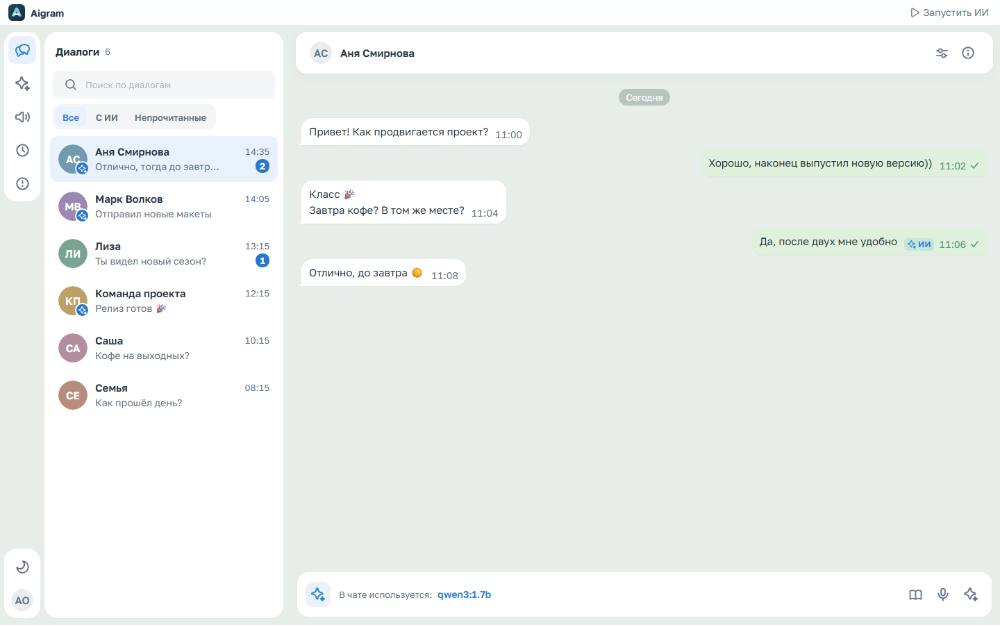
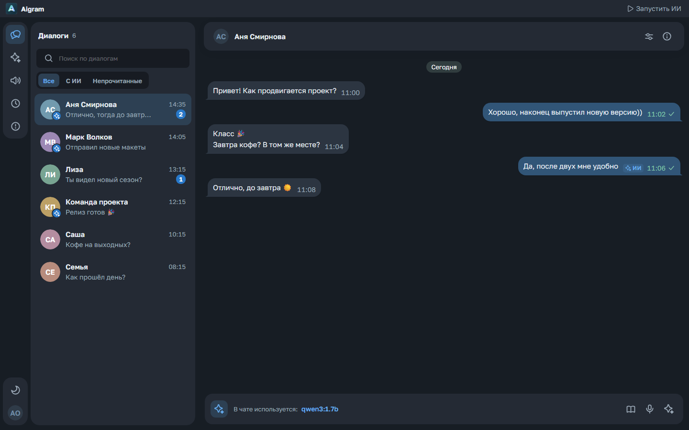
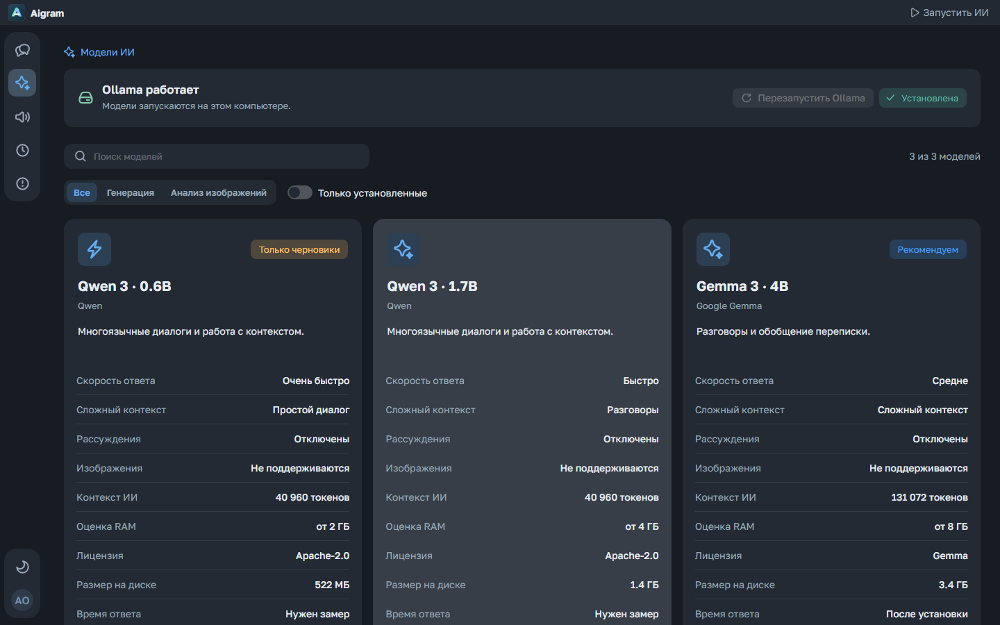
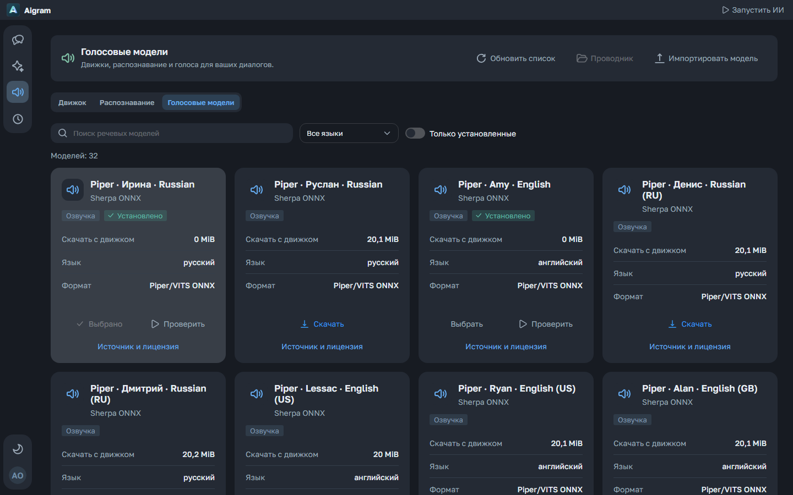
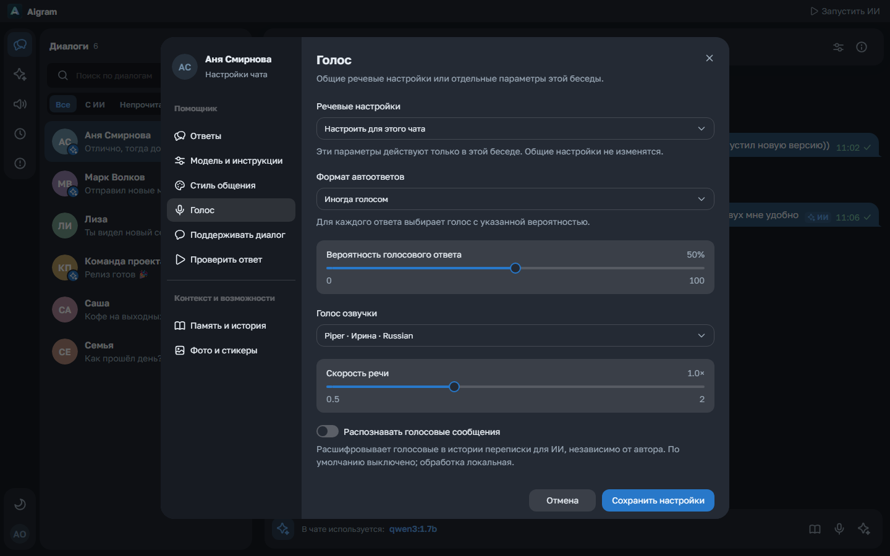
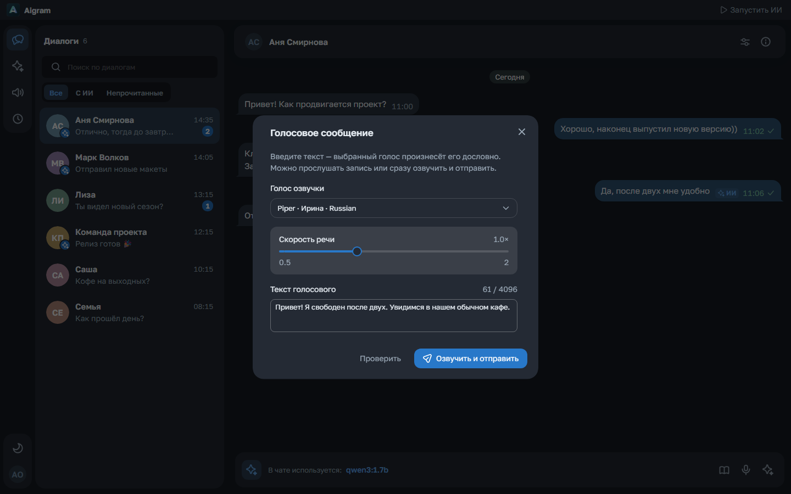
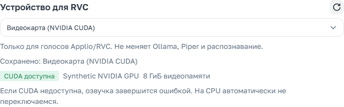

# Aigram

[English README](../README.md) · [Скачать Windows EXE](https://github.com/kreeeeeel/boltunya/releases/latest)

Aigram — приложение для Windows с помощником для Telegram. Читайте переписку, готовьте редактируемые ответы ИИ, выбирайте стиль для каждого чата и сохраняйте полезные факты в локальной памяти. Подключите установленную модель Ollama или свой API-сервер. Локальные речевые модели распознают голосовые и превращают точный текст или ответ ИИ в настоящее голосовое сообщение Telegram.



Снимки используют русский интерфейс, вымышленные диалоги и синтетические данные оборудования. В [английском README](../README.md) находится отдельная английская галерея. Личной переписки в этих примерах нет.

<table>
  <tr><td></td><td></td></tr>
  <tr><td></td><td></td></tr>
  <tr><td colspan="2"></td></tr>
  <tr><td colspan="2"></td></tr>
</table>

## Возможности

- **Переписка Telegram.** Поиск диалогов, авторы сообщений в группах, ответы на сообщения, форматирование, спойлеры, ссылки и полученные медиа. История подгружается постепенно с сохранением позиции прокрутки.
- **Черновики под вашим контролем.** Панель помощника готовит текстовые и голосовые ответы ИИ. Текстовый черновик можно изменить перед отправкой. Отдельное окно с микрофоном озвучивает введённый вами точный текст.
- **Стиль отдельно от фактов.** Встроенные и собственные стили задаются для каждой беседы. Необязательная подстройка использует настоящие исходящие сообщения и исключает известные автоответы ИИ. Свои сообщения и подписи к фото/видео редактируются с сохранением существующего оформления.
- **Локальные модели и API.** Каталог Ollama показывает контекст, ориентировочную память, лицензию и размер загрузки. Установка сопровождается прогрессом и отменой, а скорость можно измерить на своём компьютере. Для ответов, памяти и анализа изображений доступны сохранённые подключения. Управляемая приложением Ollama поддерживает выбор CPU/GPU; сторонние службы сохраняют собственные настройки.
- **Локальная речь.** Отдельный каталог предлагает русские и английские голоса, распознавание и дополнительные движки. На карточке видны формат, зависимости, общий размер и источник. Кнопка проверки открывает отдельное окно. Sherpa/Piper синтезирует обычные локальные голоса; совместимым персонажным моделям нужен дополнительный Applio/RVC. В **Настройки → Вычисления** выбирается CPU или совместимая NVIDIA CUDA для RVC; проверка голоса остаётся в **Помощник → Голос**. Настройки беседы наследуют общие предпочтения или задают свой голос и режим ответа. [Настройка речи](speech/ru.md) · [Каталог и происхождение](speech/catalog-ru.md).
- **Память в локальных файлах.** Общие факты о владельце, краткие итоги бесед и редактируемые заметки. Автоматический сбор соблюдает интервал; ручной запуск и глубокая пересборка доступны отдельно. Объём обрабатываемых сообщений учитывает токенный бюджет модели, прогресс и отмена видны в интерфейсе. [Устройство памяти](memory/ru.md).
- **Поддержка диалога по желанию.** Разрешите сообщение ИИ или ваш заранее заданный текст после периода тишины. Повторная инициатива ждёт ответа человека. Новые входящие сообщения могут заменять текущую генерацию, собираться в следующий общий ответ или получать отдельные последовательные ответы. [Поддержка диалога](ai/conversation-support-ru.md).
- **Общая очередь.** Ответы, черновики, речь и сбор памяти можно приостановить, отменить или поставить в приоритет. В событиях доступны вход модели, полученные рассуждения, итог и статистика времени/токенов. Оценки ответов и комментарии сохраняются локально.
- **Оболочка для Windows.** Трей, отдельные настройки запуска с Windows и включения ИИ, перемещаемая шапка и открытие папок в проводнике. Центр загрузок показывает модели и движки, процент, скорость и отмену. Сгруппированные настройки, компактные элементы, четыре языка и встроенные светлая/тёмная темы. Шрифт Golos Text поставляется локально.

У чатов с разрешёнными автоответами на аватарке видна метка ИИ. **Esc** закрывает текущий диалог после открытых модальных окон. Обои используются только внутри открытого чата; недоступное изображение заменяется нейтральным фоном темы.

## Установка и первый запуск

1. **Windows x64.** Скачайте **Aigram.exe** из [Releases](https://github.com/kreeeeeel/boltunya/releases/latest). В portable-пакет входят Electron, Kotlin-бэкенд, Java runtime и веб-интерфейс. Отдельно устанавливать Java и Node.js не требуется. Для TDLib может понадобиться [Visual C++ Runtime x64](https://aka.ms/vs/17/release/vc_redist.x64.exe).
2. **Подключите Telegram.** Получите собственные API ID и API Hash на [my.telegram.org/apps](https://my.telegram.org/apps), затем введите телефон, код и пароль двухэтапной проверки, если он включён.
3. **Выберите модель.** Установленная Ollama и полные локальные модели определяются автоматически. Дополнительные модели скачиваются на странице «Модели ИИ», API-подключения задаются в настройках. Веса моделей и речевые движки загружаются отдельно; перед скачиванием проверьте размер.
4. **Настройте беседу.** Выберите стиль, контекст и предпочтения ответов. Автоотправка и голосовые функции включаются по желанию. При запуске ИИ интерфейс показывает прогрев установленной модели.

Сохранение оставляет окно настроек открытым и временно меняет кнопку на «Сохранено». Перед ручной отправкой текстовый или голосовой черновик остаётся под вашим контролем. Поведение моделей отличается: проверяйте ответы и выбирайте беседы, где уместна автоматизация.

## Данные и приватность

Профиль хранится в `%LOCALAPPDATA%\Aigram`, данные Electron — в `desktop/browser`. При обычном запуске старый профиль Tiho может быть скопирован с проверкой и атомарным переключением; исходные папки остаются для восстановления. Миграция ждёт закрытия прежнего приложения и откладывается во время передачи управления старому обновлятору. Явные переменные каталога данных сохраняют своё действие. [Хранилище и миграция](storage/ru.md).

| Каталог или файл | Содержимое |
| --- | --- |
| `settings.json` | Настройки приложения, правила бесед и инструкции владельца |
| `models/` | Подключения, защищённые ключи и инструкции моделей |
| `memory/` | Фактические итоги, профиль владельца, состояние сбора и ручные заметки |
| `telegram/`, `history/` | Сессия Telegram, медиа и наблюдавшиеся локальные сообщения |
| `speech/` | Дополнительные речевые движки, модели и созданное локально аудио |
| `activity/`, `feedback/` | События и оценки ответов |
| `desktop/updates/`, `desktop/browser/` | Передача обновления и хранилище Electron |

Веса обычной Ollama находятся в `%USERPROFILE%\.ollama\models` или каталоге `OLLAMA_MODELS`. Сторонняя служба или контейнер могут использовать другое место; приложение различает эти варианты. Учётные данные Telegram и ключи API защищаются Windows DPAPI. Коды входа и пароль двухэтапной проверки приложение не сохраняет.

Выбранная API-модель получает необходимый контекст задачи на указанном вами сервере; провайдер может брать плату. Память и подробные события могут содержать личную переписку: не публикуйте профиль и трассировки целиком. Очистка скачанных медиа сохраняет вход, настройки и память. Полный выход останавливает управляемую приложением Ollama и оставляет независимые службы работать.

## Разработка

Нужны **Windows x64, JDK 21 и Node.js 24**. Из корня репозитория:

```powershell
npm.cmd ci --prefix web
npm.cmd ci --prefix desktop
npm.cmd exec --prefix web -- playwright install chromium
./scripts/build.ps1
./scripts/test-web.ps1
npm.cmd run test:smoke --prefix desktop
npm.cmd run test:updater --prefix desktop
```

Скрипт генерирует канонический API-клиент, проверяет Kotlin/frontend/Electron, экспортирует интерфейс и создаёт `complie/Aigram.exe` с `SHA256.txt`. Браузерные и нативные проверки используют вымышленные данные или отдельные профили без входа в Telegram.

| Каталог | Назначение |
| --- | --- |
| `desktop/` | Electron, preload, обновления, трей и запуск с Windows |
| `backend/` | Kotlin, Spring Boot/MVC, Spring AI, TDLib, речь, память и очередь |
| `backend/contract/` | Канонический OpenAPI и генерируемые серверные/Kotlin/TypeScript-клиенты |
| `web/` | React, статический экспорт Next.js, Gravity UI и generated SDK |
| `scripts/`, `.github/workflows/` | Проверки, упаковка и публикация |
| `docs/` | Документация и вымышленные примеры интерфейса |

Контроллеры Spring MVC реализуют generated-интерфейсы. Бизнес-компоненты выполняют операции, extension-функции преобразуют domain и DTO. Фронтенд вызывает операции `@aigram/api-client`. Настройки и память остаются локальными JSON/Markdown-файлами. [Архитектура](architecture/ru.md) · [API-клиенты](api-client/ru.md) · [Состояние миграции](migration/ru.md).

Для самостоятельных проверок веба сначала создайте SDK:

```powershell
./gradlew.bat :backend:contract:client:typescript:generateClient --no-daemon
npm.cmd run check --prefix web
./gradlew.bat check --no-daemon
```

Когда тестовый веб-сервер уже запущен, обновите локализованные снимки с вымышленными данными:

```powershell
$env:TIHO_TEST_URL='http://127.0.0.1:3100'
Push-Location web
npm.cmd exec -- playwright test docs-screenshots.spec.ts --reporter=list
Pop-Location
```

Сценарий создаёт по шесть файлов в `docs/resources/en/` и `docs/resources/ru/`, не обращается к настоящему Telegram и не запускает модели. [Docker-инструменты](../docker/README.md) предназначены для статического просмотра и проверок JVM.

## Обновления и диагностика

Workflow **Windows release** проверяет исходники, собирает portable-приложение и выполняет браузерные/нативные проверки перед публикацией **Aigram.exe** и **SHA256.txt**. Идентичный **Boltunya.exe** сохраняет совместимость со старыми обновляторами. Ссылка последнего релиза показывает опубликованную версию; снимки и исходная документация не подтверждают публикацию или проверки ещё не выпущенной сборки.

При запуске небольшое окно проверяет стабильные GitHub Releases. Загрузка проверяется по опубликованной SHA-256. Установщик подтверждает готовность до закрытия старого процесса; новая версия должна подтвердить запуск бэкенда и интерфейса до удаления резервной копии. Ошибка сохраняет или восстанавливает предыдущую версию. При старте Windows сначала выполняется проверка обновлений, затем приложение остаётся в трее. Токен GitHub не требуется.

Если старое обновление закрыло приложение без повторного запуска, один раз откройте свежескачанный `Aigram.exe` вручную. Текущие ошибки показываются рядом с действием, а результаты заданий ИИ остаются в событиях. Отдельной страницы «Ошибки» и записи технического журнала больше нет. Старые файлы журнала сохранены, но приложение их не читает.

[Настройки](settings/ru.md) · [Речь](speech/ru.md) · [Память](memory/ru.md).

Лицензии зависимостей и происхождение моделей указаны в [NOTICE.md](../NOTICE.md). Golos Text распространяется по [SIL Open Font License](../web/src/shared/assets/fonts/OFL-GolosText.txt). У моделей и дополнительных движков разные условия. Aigram не связана официально с Telegram и владельцами персонажных голосов.
