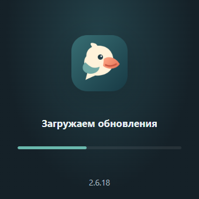
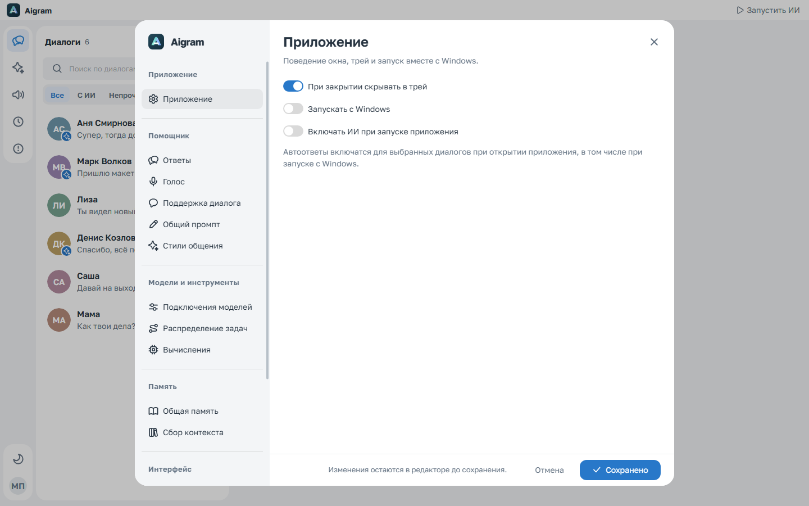
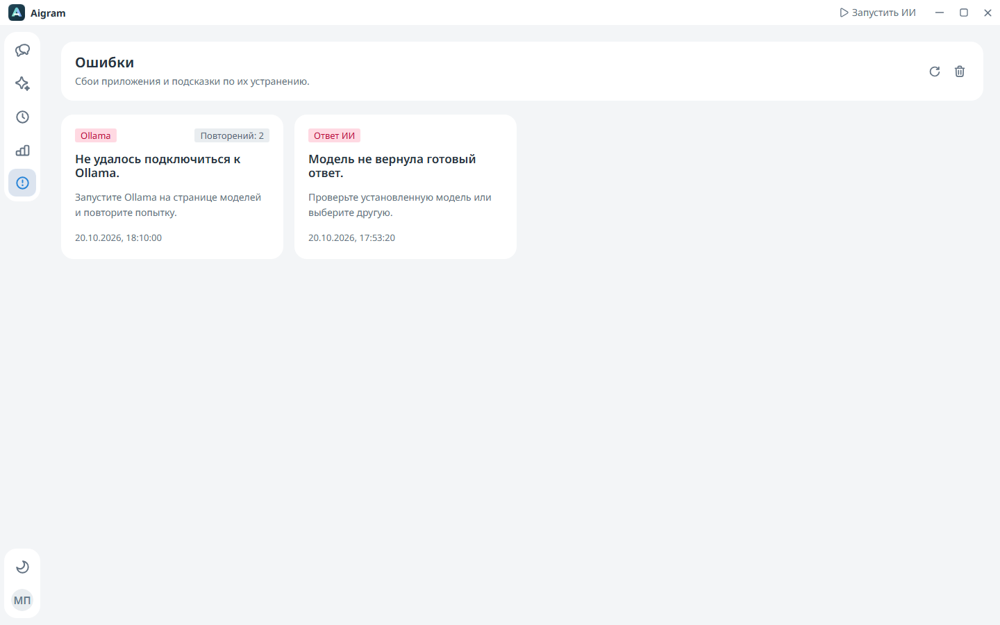

# Aigram

[English README](../README.md) · [Скачать Windows EXE](https://github.com/kreeeeeel/boltunya/releases/latest)

Aigram — приложение для Windows, в котором можно читать переписку Telegram, отвечать вручную или подключать локальный ИИ или настроенную API-модель к выбранным диалогам. Помощник учитывает историю, общую память о владельце и привычную манеру письма. Для актуальных вопросов есть бесплатный поиск без обязательного API-ключа.

Если старая версия скачала обновление, закрылась и не открылась, один раз скачайте и запустите новый `Aigram.exe` вручную. Старый вспомогательный процесс, который не выполняется, не может установить исправление самого себя. Последующие обновления используют подтверждение запуска и откат.


Скриншоты сделаны на вымышленных диалогах и примерах данных. Реальной переписки в репозитории нет. Интерфейс доступен на русском, английском, казахском и украинском.

## Установка и первый запуск

Нужна Windows x64. В [Releases](https://github.com/kreeeeeel/boltunya/releases/latest) скачайте **Aigram.exe** и запустите его. Репозиторий и релизы публичные, вход в GitHub не требуется.

Небольшое окно без рамки проверяет новую стабильную версию, показывает загрузку и устанавливает проверенный EXE перед запуском приложения. Окно можно передвигать, его размер фиксирован. Сбой сети или проверки файла оставляет установленную версию доступной. Перед закрытием старого процесса установщик подтверждает готовность. Резервная копия удаляется только после запуска бэкенда и интерфейса новой версии; если запуск не удался, восстанавливается и открывается предыдущая версия. При старте Windows сначала работает обновлятор, после него основное приложение остаётся в трее.

<p align="center"></p>

В одном portable EXE находятся Electron, Kotlin-приложение, Java runtime и веб-интерфейс. При запуске оболочка распаковывается в локальный кэш. Устанавливать Java и Node.js пользователю не требуется. Ollama и веса выбранных моделей скачиваются отдельно из приложения. Для нативной TDLib может потребоваться [Visual C++ Runtime x64](https://aka.ms/vs/17/release/vc_redist.x64.exe).

1. Нажмите **Подключить Telegram**. Получите собственные **API ID** и **API Hash** на [my.telegram.org/apps](https://my.telegram.org/apps). Рядом с полями есть инструкция и ссылка. Далее введите номер телефона, код и, если включён, пароль двухэтапной аутентификации.
2. Перейдите в **Модели ИИ**. Установленная Ollama и скачанные модели определяются автоматически; полные локальные модели видны даже при остановленном сервере. Если Ollama отсутствует, установите её через интерфейс. Кнопка установки превращается в компактный индикатор прогресса с отменой. Дополнительные модели скачиваются только по вашему выбору.
3. Откройте диалог и его **Параметры общения**. Разрешите автоответы, выберите модель, стиль, объём контекста и дополнительные инструкции. Подстройку под вашу манеру можно включать отдельно.
4. Нажмите **Запустить ИИ** в верхней панели или включите **Включать ИИ при запуске приложения** в настройках. Эта настройка действует и при обычном запуске, и при старте с Windows. Без неё помощник запускается на паузе.

## Диалоги

В списке доступны поиск, вкладки «Все», «С ИИ», «Непрочитанные» и постепенная подгрузка контактов. Превью различает ваши сообщения и сообщения участников групп. В шапке беседы показывается тег пользователя с кнопками копирования тега и Telegram-ссылки; для групп — доступная информация об участниках.

В сообщениях поддерживаются форматирование, ссылки, цитаты, спойлеры, копирование кода, фото, видео, аудио, документы и статические/TGS/WebM-стикеры. История подгружается при прокрутке вверх с сохранением позиции. Дата закрепляется сверху при прокрутке. Используются обои конкретной беседы и общий фон Telegram для светлой/тёмной темы, когда TDLib их предоставляет. По умолчанию фон однотонный и соответствует теме приложения. Такой же нейтральный фон показывается, если изображение Telegram недоступно.

ИИ отмечается небольшой круглой меткой на аватарке контакта. Подписи стилей не занимают место в списке. **Esc** закрывает открытую беседу; если сначала открыто окно настроек, закроется оно.

В группах у входящих сообщений показываются фотографии участников. Имя находится у первого сообщения серии, аватарка — у последнего. Сообщения разных авторов, тем и дат не объединяются. При отсутствии фотографии отображаются инициалы.

Фон выбранной беседы виден только при открытом чате на странице «Диалоги». Он находится за непрозрачными панелями диалогов, шапкой и полем ввода. При закрытии чата, до входа и на остальных страницах используется обычный фон интерфейса. Боковая навигация собрана в отдельные скруглённые блоки, сплошной полосы под ней нет.

Автоответы отмечаются **ИИ** в интерфейсе Aigram. Эта метка не добавляется в текст Telegram. В настройках можно выбрать ответ на исходное сообщение или обычную отправку; для форумов сохраняется тема. Анализ фотографий включается отдельно и требует модели с поддержкой изображений. Можно вручную отправлять фото, альбомы, документы и стикеры, открывать медиа в отдельном окне с масштабированием и плеером. Автоматический выбор известных Telegram-стикеров также включается отдельно.

В меню своего сообщения есть **Изменить**: редактируются текст и подписи к фото/видео. Визуальный редактор сохраняет форматирование и исходные Telegram-сущности; проверка версии защищает от перезаписи правки из другого клиента. Сохранённое сообщение обновляется на месте, окно редактора остаётся открытым. [Подробнее](messages/ru.md).


## Модели и стиль общения

Промпты учитывают выбранный стиль и указания владельца. Общий шаблон несогласия или отказа не подставляется. У отдельных моделей могут сохраняться собственные ограничения ответов.

После сохранения настроек окно остаётся открытым и показывает подтверждение. При дальнейших изменениях подтверждение исчезает; закрыть окно можно отдельно. Все сообщения Telegram передаются модели с ролью `user` в JSON-конверте: username, name, message, timestamp и проверенные сведения об авторе. Настоящие сообщения владельца отличаются от собеседников и известных автоответов. Системные инструкции объясняют формат и требуют обычный готовый ответ без копирования служебных полей. При сборе памяти авторы также сохраняются отдельно.

Во время подготовки автоответа в открытом чате показывается тот же блок процесса, что и в событиях: место в очереди или текущий этап, доступное рассуждение модели, прошедшее время и кнопка остановки. После начала отправки остановить доставку нельзя.

Примеры: [процесс ответа](resources/chat-generation.png) · [сохранённые настройки](resources/settings-saved.png).

При отмене ручного черновика незавершённый текст сохраняется; повторная попытка использует ту же очередь. Ошибка показывается одним закрываемым уведомлением в диалоге. Ollama, которой управляет Aigram, можно перезапустить из её карточки после смены вычислительного устройства; внешним сервисом продолжает управлять его владелец. Примеры: [отмена черновика](resources/draft-cancelled-light.png) · [результат перезапуска Ollama](resources/engine-restart-dark.png).

В каталоге 30 моделей семейств Qwen, Gemma, DeepSeek, GPT-OSS, Llama, Mistral и Phi. Поиск работает по названию, идентификатору и описанию. В карточке можно сравнить относительную скорость, качество работы с контекстом, режим рассуждений, контекстное окно, примерную память, размер загрузки и лицензию.

Скорость и требования зависят от компьютера. Встроенная проверка измеряет время ответа и скорость генерации на вашем устройстве; результаты сохраняются после перезапуска. При выборе установленной модели без замера проверка запускается автоматически. До замера и установки карточка показывает соответствующий статус, а не выдуманные числа. Размер контекста в карточке — ёмкость модели из каталога Ollama; рабочий бюджет зависит от выбранного подключения и его настроек.

По умолчанию диалоги следуют общему выбору модели. Отдельную модель можно назначить в параметрах беседы; пункт «По умолчанию» возвращает общий выбор. Кнопка скачивания превращается в индикатор с заливкой и процентами; при наведении или фокусе появляется «Отменить». Условия использования зависят от лицензии конкретной модели.

Генерация работает через Spring AI с типизированными сообщениями, отдельными рассуждениями и статистикой. Окно недавней переписки собирает ChatMemory, долговременные сведения остаются в MEMORY.md. Сервисы внедряются через конструкторы Spring Boot. Контроллеры Spring MVC реализуют сгенерированные интерфейсы OpenAPI; бизнес-компоненты и stateless extension-функции отделяют DTO от domain. [Состояние миграции](migration/ru.md). Подробности: [архитектура ИИ](ai/ru.md).

Настройки промпта показывают рабочее окно модели, резерв ответа и оценку места для истории. Дополнительные инструкции сохраняются отдельно для каждой модели и подключения. Если обязательный контекст не помещается, приложение показывает ошибку с лимитом, сохраняя последний вопрос. [Токены и промпты моделей](ai/prompts-ru.md).

Выбранный встроенный или именованный стиль передаётся отдельным блоком системных инструкций после фактического контекста. Необязательная подстройка использует настоящие исходящие сообщения для слов и пунктуации только в рамках выбранного стиля; известные автоответы ИИ исключаются. Автоматическая память больше не хранит манеру письма.

Свои стили создаются в соответствующем разделе настроек: название, эмодзи и инструкции. Стиль меняет подачу ответа; сведения о владельце и текущие факты не должны выдумываться ради роли.


## Единые настройки и подключения моделей

Меню профиля открывает единый центр настроек: разделы и подпункты слева, содержимое справа, действия сохранения закреплены снизу. Переключение разделов сохраняет несохранённые правки. Здесь находятся общий промпт, стили, память, языки, темы, данные и кэш.

В разделе моделей можно добавить API-подключение: провайдер, адрес, идентификатор модели, ключ, параметры генерации, таймауты и возможности. Сохранение не отправляет запрос; проверка запускается отдельной кнопкой и может тарифицироваться провайдером. При выборе API-модели контекст соответствующей задачи передаётся указанному серверу. Ключи защищены Windows DPAPI, привязаны к адресу подключения и не возвращаются в интерфейс. Локальные модели остаются доступны через Ollama.

Необязательная маршрутизация позволяет выбрать отдельные модели для ответа, памяти, поиска и анализа изображений. Это разделение задач не гарантирует ускорение одной видеокарты: локальные обращения согласованы по общему ресурсу. Внешние серверы могут работать параллельно в пределах установленного лимита.

Автоответы, ручные черновики и сбор памяти используют общую очередь. По умолчанию выполняется одна задача; можно разрешить до четырёх одновременно. Интерфейс показывает предполагаемую нагрузку и фактическую память компьютера. Отправка в одну беседу сохраняет порядок. Ручная генерация готовит текст в поле ввода и сама его не отправляет.

В оформлении доступны базовая тема, цветовые параметры и собственный CSS рабочего пространства. CSS разбирается и ограничивается областью приложения; центр настроек остаётся доступным для сброса. Сценарии удалены из интерфейса и API; старые пользовательские файлы не удаляются.



## Поиск актуальной информации

Поиск включается в параметрах конкретной беседы. Личная переписка, короткие реакции и вопрос о времени компьютера обычно обходятся без интернета.

- Погода: Open-Meteo, уточнение города, текущие условия и прогноз на нужный день.
- Официальные курсы: XML Банка России с датой действия курса, учётом номинала и кросс-курсов. Это справочный курс ЦБ, а не цена покупки наличных в банке.
- Новости: датированные RSS РБК и ТАСС, отбор по теме и региону, отсечение старых и недатированных материалов.
- Остальные вопросы: DuckDuckGo с резервом Bing RSS. Exa MCP — дополнительный резерв, только если вы сами сохранили ключ; без ключа Exa не вызывается.

Короткие уточнения продолжают последнюю проверенную тему: например, «а завтра?», «а евро?», «а в мире?» и «дай источник». Ответ должен быть коротким и разговорным, в вашей манере, с точными значащими цифрами и датами. Источник не превращается в сухую справочную карточку.

Ссылки можно показывать по просьбе собеседника, всегда после поиска или полностью отключить. Проверка ответа пропускает только адреса реально отобранных источников. При недоступности источников приложение сообщает, что проверить данные не удалось. Работа публичных поисковиков зависит от их доступности; локальная модель также может ошибаться.

Подробнее: [поиск, источники и API](internet/ru.md).

## Общая память и контекст беседы

Память хранится в Markdown внутри локального профиля:

```text
memory/
  MEMORY.md
  <account-id>/
    PROFILE.md
    state.json
    <chat-id>/
      MEMORY.md
```

Общая память содержит подтверждённые факты о вас, интересы, бытовые привычки и содержательные предпочтения из ваших настоящих сообщений. Сообщения собеседников и известные автоответы ИИ не считаются вашими словами. Память беседы хранит отношения, важные события и договорённости. Манера речи и инструкции о стиле в автоматические сводки не включаются. В каждом файле есть редактируемые заметки и автоматически обновляемая сводка; сбор контекста сохраняет ваши заметки. Старые автоматические сводки временно не используются в генерации до фактического пересбора выбранных бесед.

Фоновое обновление соблюдает заданный интервал для каждой используемой беседы, включая порции старой истории. Расписание сохраняется после ошибки, отмены и перезапуска приложения. Оно не обходит без необходимости весь Telegram. В параметрах общения можно принудительно обновить новые сообщения или перестроить контекст по всей доступной истории без ожидания интервала. Для общего профиля есть отдельный запуск сбора.

Во время работы видны состояние, очередь, число просмотренных сообщений и отмена. Сбор продолжается после закрытия модального окна; генерация ответов имеет приоритет. Сводка сжимает историю и не гарантирует дословного сохранения каждого сообщения.

Подробнее: [memory bank](memory/ru.md).

[Проверка 21 октября](ai/model-quality-2026-10-21.md) отдельно фиксирует результаты настоящей генерации: GPT-OSS сохранила факты и деловое оформление, но не выполнила требование мата в грубом стиле; R1 в двух попытках не начала выдавать поток. Эти результаты не подменяются успешными тестами передачи промпта.

## Автоответы и группы

Сообщения обрабатываются последовательно. Настраиваются задержка перед ответом, интервал между отправками и показ «печатает». В группах автоответы изначально выключены. Глобально или для конкретной группы можно разрешить ответы при упоминании либо чтение всех сообщений для участия в разговоре.


## Настройки, трей и ресурсы

На странице «События» можно приостановить очередь, остановить задачу или повысить её приоритет. Карточки показывают этапы и поток рассуждений, а модалка — промпты, ответы, расход токенов и время работы. Готовый ответ можно оценить и оставить комментарий; оценки сохраняются локально и не дообучают модель автоматически. Полная история событий сохраняется локально и загружается страницами после перезапуска; срок хранения и квота настраиваются. Общего ограничения генерации в 180 секунд нет: поток завершается по таймауту только после десяти минут без нового фрагмента, включая рассуждения. [Очередь и история запросов](activity/ru.md).

[Архив событий](resources/history-dark.png) · [Выбор языка](resources/settings-language-light.png) · [Выбор цвета](resources/appearance-color-picker.png)

Если ИИ выключен, под описанием доступна кнопка включения. На странице «Ошибки» сбои собраны в карточки: время, количество повторений, объяснение и способ исправления. Подробности открываются в модальном окне. В журнал ошибок не копируются тексты переписок, промпты и ключи.



[Подробности ошибки](resources/error-details.png) · [Форматирование памяти](resources/memory-formatted.png) · [Расположение файлов](resources/storage-locations.png)

В меню профиля находятся настройки и выход из аккаунта. Языки, оформление, инструкции, стили и память доступны в едином центре настроек. Верхняя панель управляет запуском ИИ и окном. Разворачивание учитывает панель задач Windows.

Сохранение настроек оставляет окно открытым: на кнопке ненадолго появляются галочка и «Сохранено». В памяти отображается Markdown с заголовками, списками и выделением текста. При обновлении переписки временные идентификаторы отправленных сообщений заменяются постоянными, а старые страницы истории сохраняются.

Можно выбрать закрытие в трей или полный выход. При запуске с Windows приложение остаётся только в трее, пока вы сами не откроете окно; автоматическое включение ИИ задаётся отдельно. В трее доступны открытие окна, переключение ИИ, настройки и завершение. При обычном запуске до авторизации трей не показывается.

На странице графиков доступны CPU, память, процессы приложения и Ollama, скорость сети и GPU при поддерживаемом источнике данных. Показания сети относятся к системным интерфейсам, а не исключительно к Telegram.

В настройках можно выбрать автоматическое размещение, CPU или обнаруженную NVIDIA для Ollama, которую запускает приложение. Настройка применяется при следующем запуске управляемого процесса. Для внешней службы, Docker или удалённого сервера показано ограничение; их процессы не останавливаются. AMD и Intel остаются под автоматическим управлением Ollama. [Выбор устройства](ai/gpu-ru.md).

В настройках есть автоскачивание медиа, размер кэша и очистка. Очистка скачанных файлов сохраняет вход, модели, настройки, память и сохранённые тексты. Удалённые сообщения можно сохранить только если приложение успело их увидеть; старые удалённые сообщения из Telegram восстановить нельзя.

## Хранение и приватность

Профиль находится в `%LOCALAPPDATA%\Aigram`, включая данные Electron в `desktop/browser`. При обычном запуске приложение копирует прежний профиль Tiho и выбранный профиль Electron, проверяет копию и атомарно переключает папку. Исходные папки остаются резервной копией; новые записи идут в Aigram. Перенос требует закрытой старой версии и откладывается на время незавершённого обновления. Явно заданная переменной окружения папка имеет приоритет. Подробнее: [перенос профиля](storage/ru.md#перенос-профиля).

В настройках раздел расположения файлов показывает фактические пути и открывает доступные папки в Проводнике. Там есть память, профиль, кэш Telegram, диагностика, Ollama и её модели. Для внешнего сервера Ollama локальный путь может быть неизвестен — интерфейс отмечает это отдельно. Скачанная модель сначала прогревается; до завершения загрузки в память кнопка показывает «Прогревается».

| Файл или папка | Содержимое |
| --- | --- |
| `models/prompts.json` | Инструкции по моделям, рабочий контекст и оценка токенов |
| `activity/` | История событий, полные запросы и политика хранения |
| `settings.json` | Настройки, правила бесед, инструкции |
| `telegram.credentials` | API ID / API Hash, защищённые Windows DPAPI |
| `telegram/` | Сессия TDLib и скачанные медиа |
| `memory/` | Общая память и память бесед |
| `history/` | Снимки наблюдавшихся сообщений |
| `automated-replies.json` | Идентификаторы известных автоответов |
| `engine/` | Управляемый приложением Ollama |
| `diagnostics/` | Ограниченный журнал технических ошибок |
| `feedback/activity.json` | Локальные оценки ответов и комментарии |
| `desktop/updates/` | Проверенные обновления и состояние обновлятора |
| `desktop/browser/` | Настройки Electron, браузерное хранилище и кэш |
| `search.credentials` | Необязательный ключ Exa, защищённый DPAPI |

Код входа и облачный пароль приложение не сохраняет. Переписка и память обрабатываются локально. Для поиска внешним сервисам передаётся короткий сформированный запрос, для погоды — город, а не целый диалог или Telegram credentials. Markdown-память и история содержат личные сведения и остаются в вашем профиле.

Полный выход останавливает Ollama, запущенную самим приложением. Отдельно запущенный внешний сервер Ollama не завершается. Скрытие в трей оставляет приложение работать. Профиль, credentials, локальные логи и сборки исключены из Git.

Подробнее: [кэш и хранение](storage/ru.md).

## Разработка и архитектура

Стек: Kotlin 2.3 / JDK 21, Spring Boot 4.1, TDLight / TDLib, Ollama, Electron 44, TypeScript, Next.js 16, React 19, Gravity UI 7, next-intl, Recharts и OSHI. Интерфейс статически экспортируется и обслуживается локальным Kotlin-процессом.

| Каталог | Назначение |
| --- | --- |
| `desktop/` | Electron, окно, preload, трей, автозапуск |
| `backend/` | Kotlin, Telegram, ИИ, память, поиск, локальный HTTP API |
| `backend/contract/` | Единый OpenAPI по функциям, generated Spring API/DTO, Kotlin- и TypeScript HTTP-клиенты |
| `web/` | Интерфейс, темы, переводы, сгенерированные типы API |
| `.github/workflows/` | CI и публикация Windows-релизов |
| `docker/` | Контейнеры для проверок и предпросмотра |
| `scripts/` | Сборка и проверки на Windows |
| `docs/` | Документация и тестовые скриншоты |
| `complie/` | Итоговый EXE и SHA256; не хранится в Git |

Основной пакет — `ru.aigram`. Внедрение зависимостей использует Spring Boot. Конкретные исключения находятся в `exception/impl`, коды и тексты ошибок разделены. Промпты, словари языков, тексты ошибок и каталог моделей вынесены в `backend/src/main/resources`. Единый OpenAPI начинается с `backend/contract/api/schema/api.yaml`; операции разделены по функциям, модели и enum — по файлам. Gradle проверяет ссылки и собирает контракт перед генерацией Spring API/DTO, Kotlin WebClient и полноценного TypeScript HTTP-клиента. Generated-код остаётся в `build/`. Локальный servlet API реализует сгенерированные интерфейсы через контроллеры, бизнес-компоненты и extension-функции преобразования DTO. Domain-модели разделены на chat, media, memory, ai, settings, events и system. Используются обычное внедрение через единственный конструктор и `ObjectProvider` для ленивых зависимостей. Production-запросы веба теперь вызывают generated-операции по функциям из `@aigram/api-client`; workspace alias указывает на SDK, созданный из единого контракта. Старые `openapi-fetch`, `openapi-typescript` и промежуточный schema-файл удалены. [Модули и использование клиентов](api-client/ru.md).

Локальный API защищён сессионным секретом и проверкой Host/Origin. Renderer не имеет доступа к Node.js; preload открывает ограниченный IPC. Шрифты Noto Sans встроены локально и покрывают все четыре языка.

### Сборка

Windows x64, JDK 21 и Node.js 24:

```powershell
npm.cmd ci --prefix web
npm.cmd ci --prefix desktop
npm.cmd exec --prefix web -- playwright install chromium
./scripts/build.ps1
./scripts/test-web.ps1
npm.cmd run test:smoke --prefix desktop
```

`build.ps1` проверяет Kotlin, frontend и Electron, экспортирует веб, собирает Java runtime и создаёт `complie/Aigram.exe` с `SHA256.txt`. Браузерные проверки поднимают временный локальный сервер. Нативные smoke-тесты используют отдельный тестовый профиль без входа в Telegram.

Отдельные проверки:

Windows-скрипт генерирует канонический TypeScript SDK перед npm-проверками. Для самостоятельных веб-команд сначала выполните `./gradlew.bat :backend:contract:client:typescript:generateClient --no-daemon`: `sdk:check` проверяет результат, отдельной схемы фронтенда нет. Docker создаёт тот же клиент на JDK-этапе сборки.

```powershell
$env:JAVA_TOOL_OPTIONS='-Djdk.net.unixdomain.tmpdir=C:/tiho-no-unix-sockets'
./gradlew.bat check --no-daemon
npm.cmd run check --prefix web
npm.cmd run check --prefix desktop
```

Необязательные проверки настоящего поиска используют заранее установленную `gemma3:4b`, работающую Ollama и интернет. Они задают вымышленные вопросы и не отправляют сообщения в Telegram:

```powershell
$env:TIHO_LIVE_INTERNET='true'
./gradlew.bat :backend:test --tests 'ru.aigram.ai.Live*' --no-daemon
```

Полный прогон качества на **каждой установленной модели** выполняет 20 сценариев с настоящей локальной генерацией: разговор, рецепт, контекст, манера владельца, рассуждения, погода, новости, валюты, уточнения и шесть встроенных стилей. Внешние факты здесь фиксированы для воспроизводимости. Отсутствующие модели не скачиваются; отчёт сохраняется после каждого случая в `backend/build/reports/model-quality.json`.

```powershell
$env:TIHO_LIVE_AI='true'
./gradlew.bat :backend:test --tests 'ru.aigram.ai.LiveModelQualityTest' --no-daemon
```

Текущий `qwen3:4b` требует режима с рассуждениями и отличается от instruct-варианта. Рассуждения остаются в отдельном поле. Пустой ответ или обрыв со стороны провайдера показываются как явная ошибка. Самописные регулярные выражения для оценки фраз и запрет повторов удалены. Ограниченное исправление осталось для точных чисел из проверенного поиска. Обобщённый профиль задаёт манеру, а полнота ответа зависит от вопроса. Настройка «Игнорировать задания помощнику» отсеивает рецепты и похожие запросы до автоматической генерации; вручную их можно проверить в предпросмотре.

Модели, не прошедшие проверку автоматизации, помечены **«Только черновики»**. В этой версии `qwen3:0.6b` ограничена после провала проверки вредной просьбы: её можно скачать, выбрать при приостановленном ИИ и проверить вручную, а автоматическая отправка блокируется. Выбранная модель сохраняется. На явную просьбу напомнить договорённость разрешается повторить факты из истории. Память передаёт факты отдельно от выбранного стиля; дословные фразы из посторонних тем не служат примерами ответа. В меню сообщения можно исключить из будущего контекста одну реплику или диапазон, а затем вернуть их. Автоматическая память пересобирается с учётом исключений; ручные заметки сохраняются, исходные сообщения остаются видны.

### CI и релизы

Если ИИ не работает на другом компьютере, соберите [диагностический отчёт](diagnostics/ru.md). Скрипт `Diagnose-AI.ps1` приложен к релизу: он проверяет доступность приложения и Ollama, установленные модели и настройки автоматизации, а по флагу `-TestModel` запускает тестовый ответ. Переписки, ключи, промпты и тексты ответов в отчёт не включаются.

Результаты проверки семи установленных моделей, примеры ответов и замечания ручной проверки находятся в [отчёте по моделям](ai/model-quality-2026-10-16.md). В нём сохранены и неудачные ответы; успешный автотест не означает безошибочную работу модели во всех переписках.

Push в `main` или ручной запуск **Windows release** выполняет проверки, собирает portable EXE, запускает браузерные и нативные тесты, затем публикует `Aigram.exe` и `SHA256.txt` в [Releases](https://github.com/kreeeeeel/boltunya/releases). Версия состоит из major/minor исходников и номера запуска workflow. У каждой версии собственный каталог распаковки.

Для обновления старых версий в релизе также есть побайтово идентичный `Boltunya.exe`. Контрольные суммы обоих имён указаны в `SHA256.txt`. Авторизация Telegram, память и настройки сохраняются в прежнем профиле.

Проверить целостность загрузки:

```powershell
Get-FileHash -Algorithm SHA256 -LiteralPath '.\Aigram.exe'
Get-Content -LiteralPath '.\SHA256.txt'
```

Docker предназначен для проверок и статического предпросмотра, а не для контейнеризации авторизованной Windows-сессии. Подробнее: [Docker tooling](../docker/README.md).

[Архитектура](architecture/ru.md) · [Внедрение зависимостей](dependency-injection/ru.md) · [Сторонние компоненты](../NOTICE.md)

Aigram не связана с Telegram официально. Лицензии моделей отличаются; шрифт Noto Sans распространяется по SIL Open Font License.

## Распределение задач и поддержка диалога

В распределении задач доступны все установленные локальные модели и API-подключения. Для ответов, памяти, поиска и анализа изображений можно выбрать разные модели. В каталоге есть фильтры генерации и анализа фото. [Модели для задач](ai/tasks-ru.md).

Поддержка диалога отключена по умолчанию. Её можно включить в общих настройках ответов или для отдельной беседы с собственным интервалом. После инициативного сообщения Aigram ждёт реального ответа собеседника. [Правила запуска](ai/conversation-support-ru.md).
