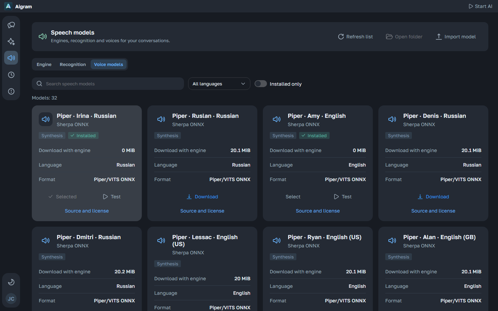

# Voice messages

Aigram can recognize incoming Telegram voice notes and synthesize spoken replies locally. Speech processing uses sherpa-onnx, Whisper tiny and optional Piper voices; your configured conversation model still writes the answer. Speech does not require an Ollama voice model or a speech API key.

## Set up

Open **Speech models** in the main sidebar, beside AI models and Events. The shared tabs separate **Engine**, **Recognition** and **Voice models**. Download **Sherpa runtime**, **Whisper tiny** for recognition, and the synthesis voices you want. Each download is explicit, shows progress inside its button and can be cancelled. The application verifies the catalog's pinned SHA-256 before installing it. Downloading a voice does not enable automatic replies.

Search the synthesis library by name and filter it by language. Installed voices can be selected and tested directly from their cards; filtering the library does not reset the chosen voice. Read each source card and its license before downloading: voice datasets have different terms, including non-commercial or unspecified terms. Character voices only support the languages shown on their cards. The optional runtime includes eSpeak NG. [Catalog and sources](catalog-en.md), [runtime and licenses](runtime-en.md).

Enable transcription under **Settings → Assistant → Voice** and choose installed recognition/synthesis models there. Automatic reply format belongs to **Settings → Assistant → Replies**, where you can choose:

- **Text:** generated automatic replies remain text.
- **Always voice:** AI-generated automatic replies are synthesized.
- **Random:** each generated reply independently uses your selected probability.
- **Voice to voice:** reply by voice only when the incoming message is a voice note. Music/audio attachments do not count as voice notes.

Open a chat’s settings and select **Voice** to inherit these global values or configure personal recognition, voice, speed, reply format and random probability. Conversation settings now use the same sidebar layout as global settings, with the chat’s avatar and name. Existing chat permissions, delays, reply/send preferences and group restrictions still apply. Exact predefined idle messages remain literal text. Speech starts disabled; opening the catalog never downloads anything.

## Processing

When recognition is enabled, each eligible voice note in the history selected for a model request is downloaded through TDLib, decoded to mono 16 kHz PCM and transcribed, including both incoming and outgoing recordings. Its transcript replaces the voice placeholder only in the model's context. Existing author/time metadata, automated-message provenance, selected style and context exclusions remain in effect. The transcript does not overwrite the Telegram message. Deleted or excluded messages are never transcribed for generation, and automated owner replies do not become real owner-style examples.

The conversation model returns a spoken-text answer. If voice is selected, Piper synthesizes it, then the codec produces an OGG/Opus voice note with duration and a Telegram waveform. Sending uses TDLib's native voice-note content, including the reply target and topic. Automatic sends retain their AI provenance.

Recognition and synthesis run within the same reply queue. Event cards show **Transcribing** and **Synthesizing**. Speech inference is additionally limited to one isolated worker at a time, with two CPU threads and a 512 MB JVM heap limit; native model allocations are additional. Cancelling a task interrupts its work and terminates its own speech worker. It does not stop another application's Ollama process.

Preparation is limited to the history or memory batch already selected for the current task; it never scans all chats to find recordings. Session transcripts are reused with account, connection, message revision, file identity and recognition-model checks. Memory batching rechecks its token budget after transcription and reduces the batch without skipping unprocessed sources. Inputs are limited to 25 MiB and ten minutes per recording; synthesis accepts up to 4,096 UTF-16 units and ten minutes of output. A history with many recordings can take substantial CPU time and remains cancellable through the shared queue.

## Preview before sending

The composer's right-hand **Voice message** button opens a manual text-to-speech dialog. Choose an installed voice and speed, then enter up to 4,096 UTF-16 units of text. **Test** optionally creates a playable preview. The main **Speak and send** action queues synthesis of the exact text and sends the resulting voice note; an unchanged ready preview is reused. Changing the text, voice or speed invalidates old audio, and **Speak and send** creates a replacement automatically. These choices belong to this draft and do not overwrite global preferences. No conversation model is called, and the normal composer text is preserved. Emoji and sticker pickers have been removed from the composer; existing Telegram media/stickers still display normally.

Manual synthesis uses the shared queue and produces a recording bound to the current account and chat. **Cancel**, closing the dialog or leaving the chat clears the intention to send before the Telegram request begins. Repeated clicks do not send the same recording twice. After confirmed delivery, a chat-refresh error offers **Refresh chat**, which does not resend the recording. If delivery cannot be confirmed, sending that recording again is blocked: check the chat and create new audio before trying again.

In a conversation, open **Prepare an AI reply** and choose **Text reply** or **Voice reply**. A voice draft has a player and editable transcript. Editing the text invalidates the old recording immediately. Use **Update voice** to enqueue synthesis of exactly the edited text; it does not ask the conversation model to rewrite it. Sending stays disabled until the new recording is ready. Your ordinary composer draft is preserved.

Draft audio is served only through the authenticated local API and is bound to the current account and conversation. It is temporary; uncertain native uploads are retained to avoid deleting a file TDLib may still be using. No private transcript is placed in a process command line or public error log.

Outgoing voice notes and attachments use a separate owned copy under `telegram/files/outgoing`, so removing a staged upload or expiring a draft does not break the sent message. This cache is bounded to 500 MiB and 1,024 entries; completed copies expire on later cleanup after 24 hours and can be cleared in storage settings. Active or uncertain native uploads stay pinned, including after a timeout/restart, and count against the limit. They are not silently deleted to make space. Cache statistics include these copies; Telegram can redownload a sent remote file after a completed local copy has been cleared.

## Test and import voices

The dedicated voice library (synthetic English UI data):

An installed card’s **Test** action opens a separate voice-preview dialog that speaks exactly the text you enter. An installed card's **Test** action previews that voice without changing your global selection. **Choose** explicitly saves the default model. Global **Settings → Assistant → Voice** also has a preview for testing unsaved voice and rate preferences. Both use the shared queue, with progress, cancellation and playback. They never call the conversation model or send a Telegram message. Preview-only recordings cannot be submitted as outgoing drafts. Local testing also works before Telegram sign-in.

The catalog toolbar has **Refresh list**, **Open in Explorer** and **Import model**, using the same controls as the storage settings. Refresh rereads the installed assets. In the desktop application, Explorer opens only the active profile's fixed `speech` directory once it exists; it cannot open an arbitrary supplied path.

Import accepts a compatible **sherpa-onnx VITS/Piper `.tar.bz2` package**, up to 100 MiB compressed and 512 MiB expanded. It must contain a single top-level directory with one ONNX model, `tokens.txt` and complete `espeak-ng-data` (including `phondata`, `phonindex` and `phontab`). Original license/model-card files are preserved. Sign in to Telegram before importing, then set a descriptive name, optional language and license information; imported voices appear in the normal synthesis selector and persist after restarting Aigram. The official runtime remains a separate verified download. Import validates the package structure; user-entered license information does not verify its provenance or grant usage rights.

User import currently accepts compatible Piper archives, not arbitrary recordings or RVC checkpoints. Curated RVC voices use their separately listed Applio engine and base Piper voice. Importing a recording does not clone a voice. Damaged or incompatible packages produce an error and do not replace installed voices. Missing imported files are reported instead of trying to download a user-supplied model from an invented URL.

## Storage and verification

The catalog, title-bar progress and voice settings share one status request and one timer while a download is active. An idle catalog is not polled. Opening another voice view rereads the catalog, or joins a request already in progress, so it can recover from a transient error or external file changes. Hiding the window suspends status requests; downloads continue in the backend, and returning to the window refreshes their current state. Installation, cancellation, import and explicit refresh update all open views together.

Speech assets and working files live under the active Aigram profile's `speech/` directory. The default profile is `%LOCALAPPDATA%/Aigram`; `AIGRAM_DATA_DIR` can select an isolated profile. Models live in `speech/<asset-id>`, generated previews in `speech/generated`, and temporary worker files in `speech/work`. This is separate from Ollama's model directory. The recognition cache is kept in memory. Recognized text included in model prompts, and the text entered for voice testing while signed in, can persist in the private local activity history under its retention and cleanup settings.

For isolated real verification, download the pinned test assets into `build/speech-verification` and enable `AIGRAM_LIVE_SPEECH=true`. `LiveSpeechPipelineTest` verifies installation, TTS, Opus encoding/decoding and preservation of the spoken words in Whisper's transcript; punctuation may differ. `LiveSpeechVoicesTest` exercises the catalog voices. `LiveSpeechSettingsTest` uploads a real Piper archive through the local HTTP API, imports it and synthesizes a settings sample without using a conversation model or sending anything to Telegram.

For the original speech baseline, the settings upload/import/audio check passed in 15.782 seconds with a real 21 MB Piper package. The real TTS → Opus → Whisper cycle passed in 36.130 seconds, and installation/synthesis verification for the original three voices, Irina, Ruslan and Amy, passed in 34.490 seconds. These are complete test timings on the verification machine, not latency guarantees. A previous intermittent Ruslan installation error did not recur in the final three-voice run; its cause was not determined, and test-only diagnostics were added.

The original speech release passed its backend, SDK, UI, Electron, script and 135 browser scenarios. The published [v2.6.41](https://github.com/kreeeeeel/boltunya/releases/tag/v2.6.41) passed real API/settings synthesis and playback in 34.822 seconds using the exact downloaded portable payload. Its normal portable launch preserved Telegram authorization, settings and manual memory notes. [Detailed results and optional packaged smoke](runtime-en.md#verification). Local expanded-library and manual-dialog checks have passed; publication and actual-profile verification are tracked in the release notes. Metadata verification does not claim that every voice has been downloaded and listened to.

## Expanded-library checks

The local gate passed 644 Kotlin cases (20 opt-in/platform skips), 12 installed SDK cases, 281 UI cases across full/final focused runs, and all 141 browser scenarios across full/final speech runs. Screenshot review verified both themes, 390 px width and a short 640 × 520 window, including modal field/button containment and compact outgoing audio.

Real GLaDOS and Dmitri installation/synthesis/Opus/Whisper checks passed in 77.408 s. The final HTTP upload/import/preview/manual synthesis and synthetic single-delivery check passed in 29.294 s. No real Telegram messages were sent. These are complete local test timings, not latency guarantees; published EXE verification is recorded separately.

[Speech library](../resources/en/speech-library.png) · [Chat voice preferences](../resources/en/chat-voice.png) · [Manual voice composition](../resources/en/manual-voice.png).

## Character voices and engines

The main catalog focuses on Russian and English: 17 Piper voices and 15 RVC voice-conversion models. The latter include Alice, Bratishkinoff, Stint, T2x2, itpedia, Wylsacom, Johnny Silverhand and other source-identified models. A character name identifies the community model, not an official DonationAlerts voice or endorsement. DonationAlerts does not document model export or a standalone TTS endpoint in its [public API](https://www.donationalerts.com/apidoc); its complete hosted voice list has not been replicated.

RVC first synthesizes text using its listed base Piper voice, then converts the resulting audio with Applio. The optional pinned Windows runtime downloads **6.31 GiB** and expands to approximately **9.67 GiB**, separately from the small application EXE. Its CPU process also needs substantially more RAM than Piper. Cards show the engine, format, languages and missing download sizes before installation. Choosing **Download** installs the listed prerequisites in order; the voice button includes their progress and cancellation. Shared prerequisite downloads remain available to other requested installations. No Python installer, model download or upstream web server is started merely by opening Aigram.

Real Alice verification passed with the pinned Applio runtime and community model: Piper → RVC → Opus → Whisper retained the spoken meaning, and the converted waveform differed from the base voice. Isolated installation took 420.305 s; synthesis of a 3.260 s recording took 82.607 s on two CPU threads; the whole check took 508.497 s. These are measured local timings, not latency guarantees. No Telegram messages or conversation-model requests were sent. Evidence: `build/speech-verification/rvc-proof-1434426430849561619/proof.json`. The other 14 RVC voices have verified metadata, not real audio verification.
