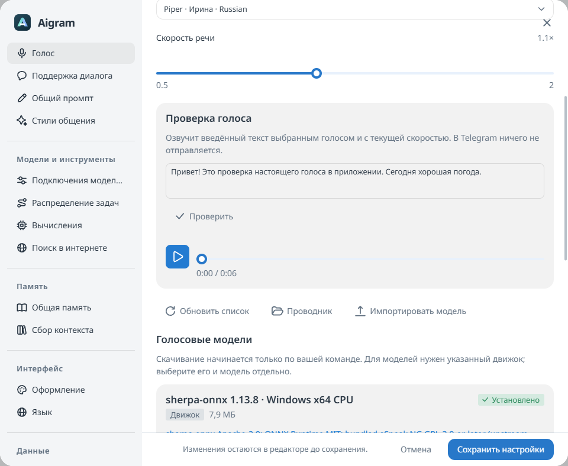

# Голосовые сообщения

Aigram может локально распознавать входящие голосовые Telegram и озвучивать ответы. Для речи используются sherpa-onnx, Whisper tiny и скачиваемые голоса Piper. Сам ответ по-прежнему пишет выбранная модель диалога. Ключ речевого API и отдельная голосовая модель Ollama не нужны.

## Настройка

Откройте **Голосовые модели** в основном боковом меню рядом с моделями ИИ и событиями. Общие табы разделяют **Движок**, **Распознавание** и **Голосовые модели**. Скачайте **Sherpa runtime**, **Whisper tiny** для распознавания и нужные голоса. Каждое скачивание запускается явно, показывает прогресс внутри кнопки и поддерживает отмену. Перед установкой проверяется закреплённая SHA-256. Скачивание голоса не включает автоответы.

В каталоге озвучки есть поиск по названию и фильтр языка. Установленный голос можно выбрать и проверить прямо из карточки; фильтрация не сбрасывает текущий выбор. Перед скачиванием смотрите исходную карточку и лицензию: встречаются некоммерческие и неуточнённые условия данных. Персонажные голоса поддерживают только указанные в карточках языки. Дополнительный runtime содержит eSpeak NG. [Каталог и источники](catalog-ru.md), [лицензии и устройство runtime](runtime-ru.md).

Распознавание включается в **Настройки → Помощник → Голос**; там выбираются установленные модели и скорость речи. Формат автоматического ответа находится в **Настройки → Помощник → Ответы**:

- **Текст:** автоматические ответы остаются текстовыми.
- **Всегда голосом:** ответы модели озвучиваются.
- **Случайно:** для каждого ответа независимо применяется выбранная вероятность.
- **Голосом на голос:** голосовой ответ только на голосовое сообщение. Музыкальные файлы не считаются голосовыми.

В настройках отдельного чата откройте **Голос**, чтобы наследовать общие параметры или задать свои модели распознавания/озвучки, скорость, формат ответа и вероятность. Параметры чата теперь разделены по пунктам, как общие настройки; слева аватарка и имя. Разрешения беседы, задержки, ответ на сообщение и ограничения групп продолжают действовать. Точный заранее заданный текст для поддержки диалога отправляется текстом. По умолчанию речь отключена; открытие каталога ничего не скачивает.

## Что происходит

При включённом распознавании каждое подходящее голосовое из истории, выбранной для запроса модели, загружается через TDLib, преобразуется в моно PCM 16 кГц и распознаётся — и входящее, и исходящее. Только в контексте модели вместо заглушки появляется расшифровка. Авторы, время, признак автоматического сообщения, выбранный стиль и исключения из контекста сохраняются. Само сообщение Telegram не изменяется. Удалённые и исключённые сообщения не распознаются, а автоответы владельца не становятся образцами его настоящей манеры общения.

Модель диалога пишет текст для произнесения. Piper озвучивает его, кодек формирует OGG/Opus с длительностью и волной. TDLib отправляет настоящее голосовое с учётом ответа на сообщение и темы беседы. Автоматическая отправка сохраняет признак ИИ.

Распознавание и озвучивание работают в общей очереди. События показывают этапы **Распознаём голос** и **Озвучиваем ответ**. Речевой движок дополнительно ограничен одним отдельным процессом, двумя потоками CPU и JVM heap 512 МБ; память нативных моделей расходуется дополнительно. Отмена прерывает задачу и завершает её речевой процесс, не затрагивая чужой Ollama.

Обрабатывается только уже выбранная история или порция памяти текущего задания; все чаты ради поиска записей не обходятся. Кэш сессии учитывает аккаунт, подключение, правку сообщения, идентификатор файла и модель распознавания. После расшифровки порция памяти повторно подбирается под токенный бюджет без пропуска оставшихся источников. Ограничения: до 25 МиБ и десяти минут на запись; текст озвучивания до 4096 единиц UTF-16, результат до десяти минут. История с большим числом голосовых может обрабатываться заметное время; задание остаётся в общей очереди и поддерживает отмену.

## Проверка перед отправкой

Справа в поле ввода кнопка **Голосовое сообщение** открывает ручную озвучку. Выберите установленный голос и скорость, затем введите до 4096 единиц UTF-16 текста. **Проверить** позволяет предварительно создать и прослушать запись, но это необязательно. Основная кнопка **Озвучить и отправить** ставит в очередь синтез точного текста и отправляет готовое голосовое; уже готовая неизменённая запись используется повторно. Правка текста, голоса или скорости делает старое аудио недействительным, и основная кнопка автоматически создаёт замену. Выбор относится только к этому черновику и не меняет общие настройки. Чат-модель не вызывается, обычный текст в поле сообщения сохраняется. Пикеры эмодзи и стикеров из композера убраны; уже существующие медиа и стикеры Telegram продолжают отображаться.

Ручная озвучка работает в общей очереди, а запись привязана к текущему аккаунту и беседе. **Отмена**, закрытие окна или переход в другой чат снимают намерение отправки до начала запроса в Telegram. Повторные нажатия не отправляют одну запись дважды. После подтверждённой отправки ошибка обновления диалога предлагает **Обновить диалог** — без повторной отправки. Если результат отправки неизвестен, повтор для этой записи блокируется: проверьте диалог и создайте новое аудио перед следующей попыткой.

В диалоге откройте **Подготовить ответ с ИИ** и выберите текст или голос. Голосовой черновик содержит плеер и редактируемый текст. Изменение текста сразу делает старую запись недействительной. **Обновить голос** ставит в очередь озвучивание именно исправленного текста без повторного переписывания моделью. До готовности новой записи отправка недоступна. Обычный черновик в поле сообщения сохраняется.

Аудио доступно только через защищённый локальный API для текущего аккаунта и конкретной беседы. Записи временные; файл неопределённо завершившейся нативной отправки сохраняется, поскольку TDLib ещё может загружать его. Текст не попадает в аргументы запуска процесса и публичный журнал ошибок.

Для исходящих голосовых и вложений создаётся отдельная копия в `telegram/files/outgoing`: удаление временного upload или истечение черновика не ломает отправленное сообщение. Этот кэш ограничен 500 МиБ и 1024 записями. Завершённые копии удаляются при последующей очистке после 24 часов или через настройки хранилища. Активные и неопределённые нативные отправки остаются защищёнными, в том числе после таймаута и перезапуска, и учитываются в лимите. Ради освобождения места они не удаляются. Статистика кэша включает эти копии; удалённый локальный файл отправленного сообщения Telegram может скачать повторно.

## Проверка и импорт в настройках

Настоящий локальный синтез в изолированном профиле:

Кнопка **Проверить** на установленной карточке открывает отдельное окно: введите текст и слушайте настоящую локальную озвучку. Кнопка **Проверить** на установленной карточке запускает этот голос, не меняя общие настройки. **Выбрать** явно сохраняет модель по умолчанию. В **Настройки → Помощник → Голос** также можно проверить ещё не сохранённые голос и темп. Обе проверки работают в общей очереди, показывают состояние и поддерживают отмену. Чат-модель не вызывается, сообщения в Telegram не отправляются. Записи проверки нельзя отправить через API черновиков. Проверка доступна и до входа в Telegram.

Над каталогом находятся одинаковые по стилю кнопки **Обновить список**, **Проводник** и **Импортировать**. Обновление перечитывает установленные ресурсы. В десктопном приложении Проводник открывает только фиксированную папку `speech` текущего профиля, когда она уже существует; произвольный переданный путь открыть нельзя.

Для импорта нужен совместимый **пакет sherpa-onnx VITS/Piper `.tar.bz2`**: до 100 МиБ в архиве и 512 МиБ после распаковки. Внутри должна быть одна верхняя папка с одной ONNX-моделью, `tokens.txt` и полной `espeak-ng-data`, включая `phondata`, `phonindex` и `phontab`. Исходные лицензии и карточка модели сохраняются. Перед импортом войдите в Telegram, затем укажите понятное название, при необходимости язык и условия использования. Импортированный голос появляется в обычном выборе озвучивания и сохраняется после перезапуска. Официальный runtime скачивается отдельно с проверкой хеша. Импорт проверяет структуру пакета; введённое название лицензии само по себе не подтверждает происхождение модели и права на её использование.

Импорт пока принимает совместимые архивы Piper, а не произвольные записи или RVC checkpoint. Для RVC-голосов каталога предусмотрены отдельные Applio и базовый голос Piper. Загрузка записи сама по себе не клонирует голос. Повреждённый пакет выдаёт ошибку и не заменяет установленные модели. Если файлы своего голоса потеряны, приложение сообщает об этом и не пытается скачать его с выдуманного адреса.

## Хранение и настоящие проверки

Каталог, прогресс в панели окна и речевые настройки используют один запрос состояния и один таймер активной загрузки. В покое каталог не опрашивается. Открытие другого речевого окна перечитывает каталог или присоединяется к текущему запросу: так состояние восстанавливается после временной ошибки или внешнего изменения файлов. Скрытие окна останавливает запросы статуса; скачивание продолжается в бэкенде, а при возврате в окно состояние обновляется. Установка, отмена, импорт и явное обновление синхронизируют все открытые представления.

Речевые файлы находятся в `speech/` активного профиля Aigram. По умолчанию это `%LOCALAPPDATA%/Aigram`; отдельный профиль задаётся через `AIGRAM_DATA_DIR`. Модели хранятся в `speech/<asset-id>`, черновики в `speech/generated`, рабочие файлы в `speech/work`. Каталог моделей Ollama отдельный. Кэш распознавания находится в оперативной памяти. Расшифровки, включённые в запрос модели, и текст проверки голоса при авторизованном аккаунте могут сохраняться в приватной локальной истории событий согласно её настройкам хранения и очистки.

Для настоящих изолированных проверок положите закреплённые файлы в `build/speech-verification` и задайте `AIGRAM_LIVE_SPEECH=true`. `LiveSpeechPipelineTest` проверяет установку, синтез, Opus и сохранение произнесённых слов в расшифровке Whisper; пунктуация может отличаться. `LiveSpeechVoicesTest` проверяет голоса каталога. `LiveSpeechSettingsTest` загружает настоящий архив Piper через локальный HTTP API, импортирует и озвучивает введённый текст без чат-модели и отправки в Telegram.

Для исходной речевой версии проверка загрузки, импорта и получения аудио через настройки прошла за 15,782 секунды с настоящим пакетом Piper размером 21 МБ. Настоящий цикл TTS → Opus → Whisper прошёл за 36,130 секунды, а установка и синтез трёх исходных голосов — Ирины, Руслана и Amy — за 34,490 секунды. Это полное время тестов на проверочной машине, а не обещание скорости. Прежняя непостоянная ошибка установки Руслана в финальном прогоне трёх голосов не повторилась; причина не установлена, добавлена тестовая диагностика.

Первый речевой релиз прошёл проверки backend, SDK, UI, Electron, скриптов и 135 браузерных сценариев. В опубликованной [v2.6.41](https://github.com/kreeeeeel/boltunya/releases/tag/v2.6.41) настоящий синтез через API, настройки и прослушивание проверены за 34,822 секунды на содержимом скачанного portable. Его обычный запуск сохранил Telegram, настройки и ручные заметки памяти. [Подробные результаты и отдельная проверка EXE](runtime-ru.md#проверка). Локальные проверки расширенного каталога и ручного окна завершены; публикация и сохранение профиля проверяются отдельно в результатах релиза. Проверенные метаданные не означают, что все голоса были скачаны и прослушаны.

## Проверки расширенного каталога

Локально прошли 644 Kotlin-сценария (20 добровольных или платформенных пропусков), 12 проверок установленного SDK, все 281 UI-сценарий и 141 браузерный сценарий по полному и финальным точечным прогонам. Снимки проверены в обеих темах, при ширине 390 px и в низком окне 640 × 520: поля и кнопки помещаются в модалке, время голосового не пересекает длительность.

Настоящая установка/озвучка/Opus/Whisper для GLaDOS и Дмитрия прошла за 77,408 секунды. Финальный HTTP-тест загрузки, импорта, прослушивания, ручной озвучки и однократной отправки в тестовый Telegram gateway прошёл за 29,294 секунды. Реальным людям ничего не отправлялось. Это полное время локальных тестов, не обещание скорости; проверка опубликованного EXE записывается отдельно.

[Каталог](../resources/speech-library-dark.png) · [Ручное голосовое](../resources/manual-voice-dark.png) · [Узкое окно](../resources/manual-voice-compact.png) · [Отправленное голосовое](../resources/outgoing-voice-dark-390.png).

## Персонажные голоса и движки

Основной каталог содержит русские и английские модели: 17 голосов Piper и 15 моделей преобразования RVC. Среди них Алиса, Братишкин, Стинт, T2x2, itpedia, Wylsacom, Джонни Сильверхенд и другие модели с указанными источниками. Название персонажа обозначает общественную модель, а не официальный голос DonationAlerts. В [публичном API DonationAlerts](https://www.donationalerts.com/apidoc) не описаны выгрузка моделей или отдельный TTS; весь их серверный каталог не перенесён.

RVC сначала озвучивает текст базовым голосом Piper, затем преобразует запись через Applio. Дополнительный Windows-движок скачивает **6,31 GiB** и занимает около **9,67 GiB** после распаковки; в EXE он не включён. Отдельному процессу CPU также нужно заметно больше RAM, чем Piper. Карточки заранее показывают движок, формат, языки и размер необходимых загрузок. Кнопка **Скачать** последовательно устанавливает перечисленные зависимости; общий прогресс и отмена отражаются на карточке голоса. Зависимость, нужная другой запрошенной установке, не отменяется вместе с первой. При простом открытии Aigram не запускаются установщики Python, скачивание моделей или веб-сервер Applio.

Настоящая проверка Алисы с закреплёнными Applio и community-моделью прошла: Piper → RVC → Opus → Whisper сохранил смысл произнесённого, а преобразованная запись отличается от базового голоса. Установка в отдельный профиль заняла 420,305 с; синтез записи длительностью 3,260 с — 82,607 с на двух потоках CPU; вся проверка — 508,497 с. Это измерения, а не обещание скорости. Сообщения в Telegram и запросы к чат-модели не отправлялись. Доказательство: `build/speech-verification/rvc-proof-1434426430849561619/proof.json`. Для остальных 14 RVC-голосов проверены метаданные, но не настоящее аудио.
